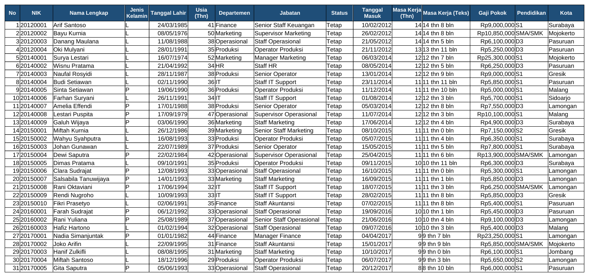

# Tutorial 01: Database Karyawan (Tingkat Pemula)

File: `01_database_karyawan.xlsx` | Latihan: [latihan.md](latihan.md) | Kembali ke [README utama](../README.md)

## 1. Tujuan dan hasil akhir

Saya membangun tabel master karyawan (80 orang) yang rapi: Format as Table, header beku, dropdown departemen dan status, kolom usia serta masa kerja yang dihitung otomatis, dan sheet Ringkasan berisi COUNTA, COUNTIF, COUNTIFS, AVERAGE, MAX, MIN, serta chart komposisi. Hasil akhirnya adalah database yang siap dipakai filter, sort, dan menjadi sumber proyek-proyek berikutnya.

## 2. Konsep Excel yang dipelajari

- Format as Table (Ctrl+T) dan nama tabel `tblKaryawan`
- Freeze Panes, Sort & Filter
- Data Validation tipe List (dropdown)
- Format tanggal `dd/mm/yyyy` dan rupiah `"Rp"#,##0`
- DATEDIF untuk usia dan masa kerja (tahun dan bulan)
- COUNTA, COUNTIF, COUNTIFS, AVERAGE, AVERAGEIF, MAX, MIN, SUM
- Conditional Formatting berbasis rumus (gaji di bawah UMK)
- Chart kolom dan kolom bertumpuk

## 3. Struktur workbook

| Sheet | Isi | Rumus kunci |
|---|---|---|
| Data Karyawan | Tabel master 80 karyawan, 17 kolom | `=DATEDIF(E2;TODAY();"Y")`, `=DATEDIF(J2;TODAY();"Y")&" thn "&DATEDIF(J2;TODAY();"YM")&" bln"` |
| Daftar | Sumber dropdown departemen, status, jenis kelamin | - |
| Ringkasan | Statistik ringkas dan tabel per departemen + 2 chart | `=COUNTA('Data Karyawan'!B2:B1000)`, `=COUNTIFS(...;$A18;...;C$17)`, `=AVERAGEIF(...)` |
| Petunjuk | Cara pakai singkat | - |

## 4. Langkah demi langkah dari nol

> Catatan: semua rumus ditulis dengan pemisah titik koma (`;`) untuk Excel regional Indonesia. Pada Excel regional Inggris ganti `;` menjadi `,`.

### Langkah 1: Siapkan header

Di sheet baru ketik header di A1:Q1: No, NIK, Nama Lengkap, Jenis Kelamin, Tanggal Lahir, Usia (Thn), Departemen, Jabatan, Status, Tanggal Masuk, Masa Kerja (Thn), Masa Kerja (Teks), Gaji Pokok, Pendidikan, Kota, Email, No. HP. Isi 5 baris data contoh dulu.

### Langkah 2: Format kolom

Blok kolom E dan J > klik kanan > Format Cells > Date > `dd/mm/yyyy`. Blok kolom M > Format Cells > Custom > ketik `"Rp"#,##0`. Blok kolom B dan Q > Format Cells > Text agar NIK dan nomor HP tidak kehilangan nol di depan.

### Langkah 3: Usia dengan DATEDIF

Ketik di F2: `=DATEDIF(E2;TODAY();"Y")`. Argumen: tanggal awal (lahir), tanggal akhir (hari ini), dan satuan `"Y"` = tahun penuh. DATEDIF tidak muncul di daftar saran Excel tetapi tetap berfungsi.

### Langkah 4: Masa kerja

Ketik di K2: `=DATEDIF(J2;TODAY();"Y")` dan di L2: `=DATEDIF(J2;TODAY();"Y")&" thn "&DATEDIF(J2;TODAY();"YM")&" bln"`. Satuan `"YM"` menghitung sisa bulan setelah tahun penuh; `&` menggabungkan teks.

### Langkah 5: Jadikan tabel

Klik sel A1, tekan Ctrl+T, centang My table has headers, OK. Di Table Design ganti Table Name menjadi `tblKaryawan` dan pilih gaya Medium 2. Rumus di baris pertama otomatis disalin ke baris baru.

### Langkah 6: Bekukan header

Klik sel D2 lalu View > Freeze Panes > Freeze Panes. Baris 1 dan kolom A-C tetap terlihat saat digulir.

### Langkah 7: Sheet Daftar dan dropdown

Buat sheet `Daftar`; isi A2:A7 dengan enam departemen dan B2:B4 dengan Tetap, Kontrak, Magang. Kembali ke Data Karyawan, blok G2:G81 > Data > Data Validation > Allow: List > Source: `=Daftar!$A$2:$A$7`. Ulangi untuk I2:I81 dengan `=Daftar!$B$2:$B$4` dan D2:D81 dengan `L,P` (ketik langsung).

### Langkah 8: Sheet Ringkasan

Buat sheet `Ringkasan`. B6: `=COUNTA('Data Karyawan'!B2:B1000)` (menghitung sel terisi = jumlah karyawan). B7: `=COUNTIF('Data Karyawan'!D2:D1000;"L")`. B9: `=AVERAGE('Data Karyawan'!M2:M1000)`. B10: `=MAX(...)`, B11: `=MIN(...)`, B12: `=SUM(...)`.

### Langkah 9: Tabel per departemen

Di A17:G17 ketik header Departemen, Jumlah, Tetap, Kontrak, Magang, Rata-rata Gaji, % dari Total. A18:A23 isi nama departemen. B18: `=COUNTIF('Data Karyawan'!$G$2:$G$1000;A18)`. C18: `=COUNTIFS('Data Karyawan'!$G$2:$G$1000;$A18;'Data Karyawan'!$I$2:$I$1000;C$17)` lalu tarik ke E23; perhatikan `$A18` (kolom terkunci) dan `C$17` (baris terkunci). F18: `=IFERROR(AVERAGEIF('Data Karyawan'!$G$2:$G$1000;A18;'Data Karyawan'!$M$2:$M$1000);0)`. G18: `=IFERROR(B18/$B$24;0)` dengan B24 = `=SUM(B18:B23)`.

### Langkah 10: Conditional Formatting

Di Ringkasan!B5 ketik UMK 4725479. Blok M2:M81 > Home > Conditional Formatting > New Rule > Use a formula > `=M2<Ringkasan!$B$5` > Format isi merah muda. Gaji di bawah UMK langsung tersorot.

### Langkah 11: Chart

Blok A17:B23 > Insert > Column > Clustered Column; beri judul. Untuk komposisi status blok A17:A23 dan C17:E23 (tahan Ctrl) > Insert > Stacked Column.

### Langkah 12: Uji

Ganti departemen satu karyawan lewat dropdown dan pastikan angka di Ringkasan berubah. Urutkan tabel dengan panah filter pada header Gaji Pokok > Sort Largest to Smallest.

## 5. Kesalahan umum dan cara memperbaikinya

- `#NUM!` pada DATEDIF: tanggal akhir lebih kecil dari tanggal awal; periksa tanggal lahir/masuk.
- NIK berubah menjadi 2019004 (nol hilang): format kolom belum Text sebelum mengetik.
- COUNTIF menghasilkan 0 padahal data ada: ada spasi di akhir teks (`HR `); gunakan TRIM atau dropdown agar ejaan seragam.
- Rumus tarik ke bawah merujuk baris salah: kunci rentang dengan `$` (tekan F4 saat mengedit).
- Tanggal tampil sebagai angka 45321: format sel belum Date.

## 6. Latihan tambahan

Kerjakan soal di [latihan.md](latihan.md); kunci jawaban rumus tersedia di bagian bawah file tersebut.

## 7. Variasi untuk tingkat selanjutnya

- Ganti `TODAY()` dengan sel tanggal acuan agar laporan tidak berubah tiap hari (dipakai di proyek 08).
- Tambahkan kolom Email otomatis: `=LOWER(SUBSTITUTE(C2;" ";"."))&"@perusahaan.co.id"`.
- Lanjut ke proyek 02 untuk menghubungkan data ini dengan absensi.
