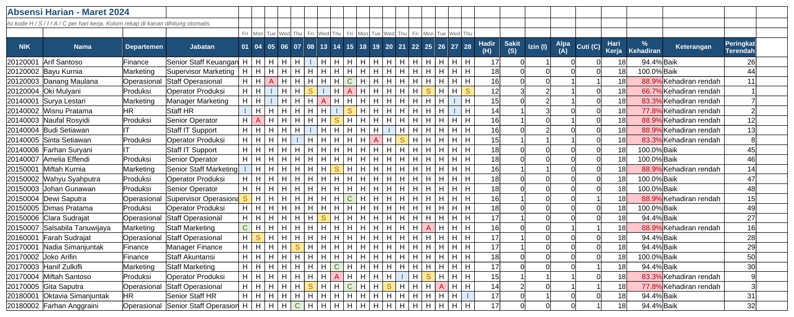

# Tutorial 02: Rekap Absensi Bulanan (Tingkat Pemula)

File: `02_rekap_absensi_bulanan.xlsx` | Latihan: [latihan.md](latihan.md) | Kembali ke [README utama](../README.md)

## 1. Tujuan dan hasil akhir

Saya membuat lembar absensi harian Maret 2024 untuk 60 karyawan dengan kode H/S/I/A/C, rekap otomatis per karyawan (COUNTIF), persentase kehadiran yang disorot merah bila di bawah 90%, dan rekap per departemen dengan SUMIF beserta chart. Hasilnya adalah laporan absensi bulanan yang siap dikirim ke manajemen.

## 2. Konsep Excel yang dipelajari

- COUNTIF pada rentang horizontal (per baris)
- COUNT untuk menghitung hari kerja dari header tanggal
- Persentase dan format `0.0%`
- Conditional Formatting: Cell Is less than, Equal To (warna per kode)
- Data Validation daftar kode
- SUMIF dan COUNTIF per departemen
- RANK.EQ + COUNTIF untuk peringkat unik
- INDEX/MATCH untuk daftar 10 kehadiran terendah
- Chart kolom dan bertumpuk
- TEXT(tanggal;"ddd") untuk nama hari

## 3. Struktur workbook

| Sheet | Isi | Rumus kunci |
|---|---|---|
| Absensi | 60 baris x 18 hari kerja + kolom rekap | `=COUNTIF($E5:$V5;"H")`, `=COUNT($E$4:$V$4)`, `=IFERROR(W5/AB5;0)` |
| Rekap Departemen | Total per departemen, 10 terendah, 2 chart | `=SUMIF(Absensi!$C$5:$C$64;A10;Absensi!$W$5:$W$64)` |
| Kode & Libur | Arti kode dan daftar libur 2024 | - |
| Petunjuk | Cara pakai | - |

## 4. Langkah demi langkah dari nol

> Catatan: semua rumus ditulis dengan pemisah titik koma (`;`) untuk Excel regional Indonesia. Pada Excel regional Inggris ganti `;` menjadi `,`.

### Langkah 1: Header tanggal

Baris 4: A4 NIK, B4 Nama, C4 Departemen, D4 Jabatan. Di E4 ketik 01/03/2024, lalu isi tanggal hari kerja berikutnya ke kanan (lewati Sabtu, Minggu, 11-12 Maret, 29 Maret). Format E4:V4 Custom `dd` agar hanya tanggal yang tampil. Di E3 ketik `=TEXT(E4;"ddd")` dan tarik ke kanan untuk nama hari.

### Langkah 2: Isi kode

Blok E5:V64 > Data Validation > List > Source `H,S,I,A,C`. Isi kode per hari. Home > Alignment > Center.

### Langkah 3: Rekap per baris

W5: `=COUNTIF($E5:$V5;"H")`; X5 untuk S, Y5 untuk I, Z5 untuk A, AA5 untuk C. `$E5:$V5` mengunci kolom sehingga rumus bisa disalin ke bawah tetapi tidak bergeser ke samping.

### Langkah 4: Hari kerja dan persentase

AB5: `=COUNT($E$4:$V$4)` menghitung tanggal di header (angka). AC5: `=IFERROR(W5/AB5;0)` lalu format `0.0%`. IFERROR menjaga agar baris kosong tidak menampilkan #DIV/0!.

### Langkah 5: Keterangan otomatis

AD5: `=IF(Z5>=2;"Peringatan alpa";IF(AC5<0,9;"Kehadiran rendah";"Baik"))`. IF bertingkat: cek alpa dulu, lalu persentase.

### Langkah 6: Peringkat terendah

AE5: `=RANK.EQ(AC5;$AC$5:$AC$64;1)+COUNTIF($AC$5:AC5;AC5)-1`. Argumen ketiga 1 = urutan naik (terendah = peringkat 1); COUNTIF dengan rentang yang memanjang memecah nilai kembar.

### Langkah 7: Conditional Formatting

Blok AC5:AC64 > Conditional Formatting > Highlight Cells Rules > Less Than > `0,9` > isi merah. Blok E5:V64 > Equal To > `A` > merah; ulangi untuk S (kuning), I (biru), C (hijau).

### Langkah 8: Freeze dan filter

Klik E5 > View > Freeze Panes. Blok A4:AE64 > Data > Filter.

### Langkah 9: Rekap departemen

Sheet baru. B4: `=Absensi!AB5` (hari kerja). A10:A15 nama departemen. B10: `=COUNTIF(Absensi!$C$5:$C$64;A10)`. C10: `=SUMIF(Absensi!$C$5:$C$64;A10;Absensi!$W$5:$W$64)` (rentang kriteria, kriteria, rentang yang dijumlah). H10: `=B10*$B$4`; I10: `=IFERROR(C10/H10;0)`.

### Langkah 10: Daftar 10 terendah

A38: 1 sampai 10. B38: `=INDEX(Absensi!$B$5:$B$64;MATCH(A38;Absensi!$AE$5:$AE$64;0))`. MATCH mencari peringkat ke-n di kolom bantu, INDEX mengambil nama pada posisi itu.

### Langkah 11: Chart

Blok A9:A15 dan I9:I15 (Ctrl) > Insert > Clustered Column. Blok A9:A15 dan D9:G15 > Stacked Column untuk komposisi ketidakhadiran.

## 5. Kesalahan umum dan cara memperbaikinya

- COUNTIF menghitung 0: kode diketik huruf kecil `h` tanpa dropdown; COUNTIF tidak peka kapital, jadi lebih mungkin ada spasi.
- Hari kerja salah: COUNT hanya menghitung angka/tanggal; header yang diketik sebagai teks tidak ikut.
- Persentase menampilkan 94,4 bukan 94,4%: hasil pembagian belum diformat persen (jangan dikalikan 100).
- Conditional Formatting Less Than 90 bukan 0,9: nilai persen disimpan sebagai pecahan.
- Peringkat ganda: lupa menambah `COUNTIF($AC$5:AC5;AC5)-1`.

## 6. Latihan tambahan

Kerjakan soal di [latihan.md](latihan.md); kunci jawaban rumus tersedia di bagian bawah file tersebut.

## 7. Variasi untuk tingkat selanjutnya

- Tambahkan kolom jam masuk/pulang dan hitung keterlambatan dengan `=IF(F5>TIME(8;0;0);"Terlambat";"")`.
- Buat satu sheet per bulan dan rekap tahunan dengan SUMIF lintas sheet.
- Gunakan PivotTable (proyek 06) untuk rekap kode per departemen.
