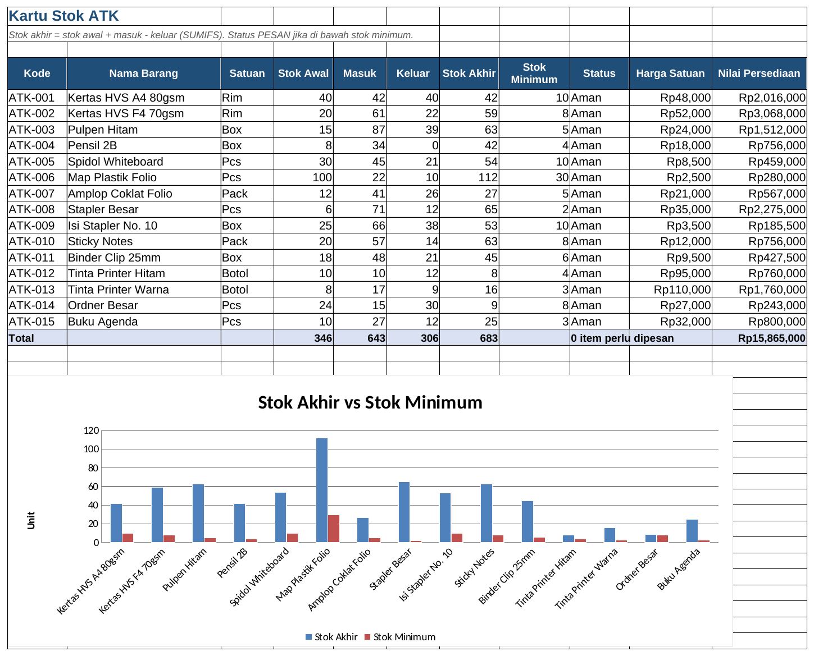

# Tutorial 03: Administrasi Surat dan ATK (Tingkat Pemula)

File: `03_administrasi_surat_dan_atk.xlsx` | Latihan: [latihan.md](latihan.md) | Kembali ke [README utama](../README.md)

## 1. Tujuan dan hasil akhir

Saya menyusun dua modul administrasi dalam satu workbook: agenda surat masuk/keluar dengan nomor otomatis, status disposisi, dan filter; serta kartu stok ATK yang menghitung stok akhir dari transaksi (SUMIFS), memberi peringatan stok minimum, dan laporan pemakaian bulanan. Hasilnya adalah sistem administrasi sederhana yang biasa dipakai staf admin/HR.

## 2. Konsep Excel yang dipelajari

- TEXT + ROW untuk nomor agenda otomatis
- CHOOSE + MONTH untuk bulan romawi
- INDEX/MATCH untuk menarik nama dan harga barang
- SUMIFS dengan 2-4 kriteria (kode, jenis, rentang tanggal)
- IF untuk status PESAN/Aman
- COUNTIF/COUNTIFS untuk ringkasan surat
- Data Validation dan Conditional Formatting status
- Format as Table, AutoFilter, Freeze Panes
- Chart batang horizontal

## 3. Struktur workbook

| Sheet | Isi | Rumus kunci |
|---|---|---|
| Surat Masuk | 60 surat, nomor agenda otomatis, disposisi | `="SM-"&TEXT(B5;"yyyy")&"-"&TEXT(ROW()-4;"000")`, `=IF(H5="Selesai";I5-B5;TODAY()-B5)` |
| Surat Keluar | 45 surat, nomor NNN/HRD/ROMAWI/TTTT | `=TEXT(A5;"000")&"/HRD/"&CHOOSE(MONTH(B5);"I";...)&"/"&YEAR(B5)` |
| Ringkasan Surat | COUNTIF status, per bulan, per disposisi + chart | `=COUNTIFS('Surat Masuk'!$B$5:$B$500;">="&G13;...;"<"&H13)` |
| Master ATK | 15 barang, stok awal, minimum, harga | - |
| Transaksi ATK | ±120 transaksi masuk/keluar | `=INDEX('Master ATK'!$B$5:$B$19;MATCH(B5;'Master ATK'!$A$5:$A$19;0))` |
| Kartu Stok | Stok akhir, status, nilai persediaan | `=SUMIFS('Transaksi ATK'!$E$5:$E$500;'Transaksi ATK'!$B$5:$B$500;A5;'Transaksi ATK'!$D$5:$D$500;"Masuk")` |
| Laporan Bulanan ATK | Pemakaian per barang per bulan | SUMIFS dengan rentang tanggal |

## 4. Langkah demi langkah dari nol

> Catatan: semua rumus ditulis dengan pemisah titik koma (`;`) untuk Excel regional Indonesia. Pada Excel regional Inggris ganti `;` menjadi `,`.

### Langkah 1: Agenda surat masuk

Baris 4 header: No. Agenda, Tanggal Terima, Nomor Surat Asal, Pengirim, Perihal, Jenis, Disposisi Ke, Status Disposisi, Tanggal Selesai, Lama Proses, Keterangan. A5: `="SM-"&TEXT(B5;"yyyy")&"-"&TEXT(ROW()-4;"000")`. ROW() memberi nomor baris (5), dikurangi 4 menjadi 1, TEXT mengubahnya menjadi `001`.

### Langkah 2: Lama proses

J5: `=IF(H5="Selesai";I5-B5;IF(B5="";"";TODAY()-B5))`. Selisih dua tanggal langsung menghasilkan jumlah hari.

### Langkah 3: Dropdown dan warna

Buat sheet Daftar (jenis surat, departemen, status). Data Validation untuk F, G, H. Conditional Formatting > Equal To `Belum` merah, `Proses` kuning, `Selesai` hijau. Tambahkan aturan rumus `=AND($H5<>"Selesai";$J5>7)` pada J5:J64 untuk surat yang menggantung lebih dari 7 hari.

### Langkah 4: Jadikan tabel

Ctrl+T pada A4:K64, nama `tblSuratMasuk`. Klik C5 > Freeze Panes.

### Langkah 5: Nomor surat keluar

Di sheet Surat Keluar A5: `=ROW()-4`; C5: `=TEXT(A5;"000")&"/HRD/"&CHOOSE(MONTH(B5);"I";"II";"III";"IV";"V";"VI";"VII";"VIII";"IX";"X";"XI";"XII")&"/"&YEAR(B5)`. CHOOSE memilih item ke-n sesuai nomor bulan.

### Langkah 6: Master dan transaksi ATK

Master ATK: Kode, Nama Barang, Satuan, Stok Awal, Stok Minimum, Harga Satuan. Transaksi ATK: pilih kode lewat dropdown `='Master ATK'!$A$5:$A$19`; C5: `=IFERROR(INDEX('Master ATK'!$B$5:$B$19;MATCH(B5;'Master ATK'!$A$5:$A$19;0));"")`. MATCH menemukan posisi kode, INDEX mengambil nama pada posisi itu. H5: `=E5*G5`.

### Langkah 7: Kartu stok

E5: `=SUMIFS('Transaksi ATK'!$E$5:$E$500;'Transaksi ATK'!$B$5:$B$500;A5;'Transaksi ATK'!$D$5:$D$500;"Masuk")` (jumlahkan kolom Jumlah bila kode cocok DAN jenis Masuk). F5 sama dengan "Keluar". G5: `=D5+E5-F5`. I5: `=IF(G5<=H5;"PESAN";"Aman")`. K5: `=G5*J5`.

### Langkah 8: Laporan bulanan

Baris 3 berisi tanggal awal tiap bulan (C3 = 01/01/2024, D3 = 01/02/2024, ...). C5: `=SUMIFS('Transaksi ATK'!$E$5:$E$500;'Transaksi ATK'!$B$5:$B$500;$A5;'Transaksi ATK'!$D$5:$D$500;"Keluar";'Transaksi ATK'!$A$5:$A$500;">="&C$3;'Transaksi ATK'!$A$5:$A$500;"<"&D$3)`. Kriteria tanggal digabung dengan `&` karena operator harus berupa teks.

### Langkah 9: Ringkasan surat

B5: `=COUNTIF('Surat Masuk'!H5:H500;"Belum")`. Tabel per bulan memakai COUNTIFS dengan dua batas tanggal seperti langkah 8.

### Langkah 10: Chart

Kartu Stok: blok B4:B19 dan G4:H19 > Insert > Clustered Column (stok akhir vs minimum). Laporan: blok B4:B19 dan J4:J19 > Bar.

## 5. Kesalahan umum dan cara memperbaikinya

- Nomor agenda berubah saat baris dihapus: ROW() dinamis; untuk arsip final salin kolom lalu Paste Values.
- `#N/A` pada INDEX/MATCH: kode belum ada di Master atau ada spasi; bungkus IFERROR.
- SUMIFS menghasilkan 0 pada rentang tanggal: kriteria ditulis `">=C3"` (teks literal) bukan `">="&C3`.
- Stok akhir negatif: transaksi keluar dicatat sebelum barang masuk; periksa urutan tanggal.
- Rentang SUMIFS tidak sama panjang: semua rentang kriteria dan jumlah harus berukuran sama.

## 6. Latihan tambahan

Kerjakan soal di [latihan.md](latihan.md); kunci jawaban rumus tersedia di bagian bawah file tersebut.

## 7. Variasi untuk tingkat selanjutnya

- Tambahkan kolom lampiran (hyperlink ke file PDF) dengan `=HYPERLINK("arsip\"&A5&".pdf";"Buka")`.
- Buat nomor otomatis yang tidak bergeser dengan `=MAX($A$4:A4)+1`.
- Gunakan PivotTable untuk laporan pemakaian per departemen pemakai.
