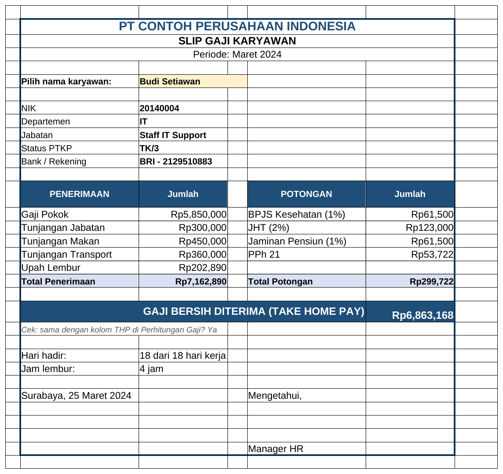

# Tutorial 04: Penggajian dan Slip Gaji (Tingkat Menengah)

File: `04_penggajian_dan_slip_gaji.xlsx` | Latihan: [latihan.md](latihan.md) | Kembali ke [README utama](../README.md)

## 1. Tujuan dan hasil akhir

Saya membangun sistem payroll bulanan (70 karyawan) dari parameter terpusat: gaji pokok, tunjangan jabatan (VLOOKUP), tunjangan makan/transport berbasis kehadiran, lembur (jam x gaji/173 x 1,5), potongan BPJS Kesehatan 1%, JHT 2%, JP 1%, PPh 21 metode TER yang disederhanakan, rekap per departemen dengan SUMIFS, dan slip gaji yang berubah lewat dropdown nama (INDEX/MATCH).

## 2. Konsep Excel yang dipelajari

- Sheet Parameter sebagai satu sumber asumsi
- VLOOKUP exact (FALSE) dan approximate (TRUE) untuk tarif berjenjang
- INDEX/MATCH lintas sheet (alternatif XLOOKUP di Excel 365)
- SUMIF untuk lembur, SUMIFS untuk rekap departemen
- MIN untuk batas atas upah BPJS, ROUND untuk pembulatan rupiah
- IF bertingkat untuk memilih tabel TER A/B/C
- Data Validation dropdown nama pada slip
- Desain slip gaji siap cetak

## 3. Struktur workbook

| Sheet | Isi | Rumus kunci |
|---|---|---|
| Parameter | Hari kerja, tarif tunjangan, iuran BPJS, tunjangan per level, PTKP, tabel TER | sel input kuning |
| Master Karyawan | 70 karyawan: PTKP, NPWP, gaji pokok | `=VLOOKUP(E5;Parameter!$A$20:$B$23;2;FALSE)` |
| Kehadiran & Lembur | Hari hadir, jam lembur, tarif lembur | `=ROUND(F5/Parameter!$B$9;0)`, `=E5*G5*Parameter!$B$10` |
| Perhitungan Gaji | Bruto, potongan, PPh 21, THP | `=ROUND(MIN(E5+F5;Parameter!$B$12)*Parameter!$B$11;0)`, `=IF(N5="A";VLOOKUP(J5;Parameter!$D$20:$E$44;2;TRUE);IF(N5="B";...))` |
| Rekap Departemen | SUMIFS per departemen + chart | `=SUMIFS('Perhitungan Gaji'!$J$5:$J$74;'Perhitungan Gaji'!$C$5:$C$74;$A5)` |
| Slip Gaji | Slip dinamis berdasarkan dropdown C6 | `=INDEX('Perhitungan Gaji'!$E$5:$E$74;MATCH($C$6;'Perhitungan Gaji'!$B$5:$B$74;0))` |

## 4. Langkah demi langkah dari nol

> Catatan: semua rumus ditulis dengan pemisah titik koma (`;`) untuk Excel regional Indonesia. Pada Excel regional Inggris ganti `;` menjadi `,`.

### Langkah 1: Parameter

Buat sheet Parameter. Isi B5 hari kerja (18), B7 tunjangan makan/hari (25000), B8 transport (20000), B9 pembagi lembur (173), B10 pengali (1,5), B11 iuran BPJS Kesehatan (1%), B12 batas upah (12000000), B13 JHT (2%), B14 JP (1%), B15 batas JP (10042300), B16 tambahan tanpa NPWP (20%). Warnai kuning. Di A20:B23 tabel level -> tunjangan jabatan. Di A27:C34 status PTKP -> kategori TER. Di D20:E44, G20:H40, J20:K41 tabel TER A, B, C (batas bawah bruto, tarif) diurutkan naik.

### Langkah 2: Master Karyawan

Kolom: NIK, Nama, Departemen, Jabatan, Level, Status PTKP, NPWP, Gaji Pokok, Tunjangan Jabatan, Bank, Rekening. I5: `=VLOOKUP(E5;Parameter!$A$20:$B$23;2;FALSE)` (cari level di kolom pertama tabel, ambil kolom ke-2, FALSE = harus persis). Dropdown Level dan PTKP merujuk Parameter.

### Langkah 3: Kehadiran & Lembur

A5: `='Master Karyawan'!A5`. B5: `=INDEX('Master Karyawan'!$B$5:$B$74;MATCH(A5;'Master Karyawan'!$A$5:$A$74;0))`. D5 hari hadir dan E5 jam lembur diisi manual. F5 gaji pokok via INDEX/MATCH. G5: `=ROUND(F5/Parameter!$B$9;0)` (upah per jam = gaji/173). H5: `=E5*G5*Parameter!$B$10`.

### Langkah 4: Perhitungan Gaji - penerimaan

E5 gaji pokok, F5 tunjangan jabatan (INDEX/MATCH ke Master). G5: `=INDEX('Kehadiran & Lembur'!$D$5:$D$74;MATCH($A5;'Kehadiran & Lembur'!$A$5:$A$74;0))*Parameter!$B$7`. H5 sama dengan `$B$8`. I5: `=SUMIF('Kehadiran & Lembur'!$A$5:$A$74;$A5;'Kehadiran & Lembur'!$H$5:$H$74)`. J5: `=SUM(E5:I5)`.

### Langkah 5: Potongan BPJS

K5: `=ROUND(MIN(E5+F5;Parameter!$B$12)*Parameter!$B$11;0)`. MIN membatasi dasar upah pada batas atas. L5: `=ROUND((E5+F5)*Parameter!$B$13;0)`. M5: `=ROUND(MIN(E5+F5;Parameter!$B$15)*Parameter!$B$14;0)`.

### Langkah 6: PPh 21 TER

N5 kategori: `=INDEX(Parameter!$B$27:$B$34;MATCH(INDEX('Master Karyawan'!$F$5:$F$74;MATCH($A5;'Master Karyawan'!$A$5:$A$74;0));Parameter!$A$27:$A$34;0))`. O5 tarif: `=IF(N5="A";VLOOKUP(J5;Parameter!$D$20:$E$44;2;TRUE);IF(N5="B";VLOOKUP(J5;Parameter!$G$20:$H$40;2;TRUE);VLOOKUP(J5;Parameter!$J$20:$K$41;2;TRUE)))`. TRUE = pencarian perkiraan: mengambil batas bawah terbesar yang <= bruto. P5: `=ROUND(J5*O5*IF(NPWP="Tidak";1+Parameter!$B$16;1);0)`.

### Langkah 7: Penyederhanaan yang saya lakukan

TER bulanan dipakai Januari-November; Desember seharusnya dihitung ulang setahun dengan tarif progresif Pasal 17 dikurangi PPh yang sudah dipotong. Tabel TER di sini cuplikan yang dibulatkan; lembur memakai pengali rata 1,5 (aturan resmi: 1,5x jam pertama, 2x jam berikutnya); iuran ditanggung perusahaan tidak dihitung.

### Langkah 8: THP dan rekap

Q5: `=SUM(K5:M5)+P5`; R5: `=J5-Q5`. Sheet Rekap Departemen: C5: `=SUMIFS('Perhitungan Gaji'!$E$5:$E$74;'Perhitungan Gaji'!$C$5:$C$74;$A5)` dan seterusnya; chart bruto vs bersih.

### Langkah 9: Slip gaji

Buat sheet Slip Gaji, gabungkan B2:F2 untuk nama perusahaan. C6 dropdown: Data Validation > List > `='Master Karyawan'!$B$5:$B$74`. C8: `=INDEX('Master Karyawan'!$A$5:$A$74;MATCH($C$6;'Master Karyawan'!$B$5:$B$74;0))`. Komponen: `=INDEX('Perhitungan Gaji'!$E$5:$E$74;MATCH($C$6;'Perhitungan Gaji'!$B$5:$B$74;0))` dan seterusnya per kolom. F22: `=C20-F20`. Di Excel 365 bisa ditulis `=XLOOKUP($C$6;'Perhitungan Gaji'!$B$5:$B$74;'Perhitungan Gaji'!$E$5:$E$74)`.

### Langkah 10: Cetak

Page Layout > Print Area > Set Print Area pada B2:F32; Margins Narrow; Scale to Fit 1 page. Ctrl+P.

## 5. Kesalahan umum dan cara memperbaikinya

- VLOOKUP TRUE salah tarif: tabel TER tidak diurutkan naik pada kolom pertama.
- `#N/A` pada slip: nama di C6 diketik berbeda dari Master (gunakan dropdown).
- Potongan BPJS kebesaran: lupa MIN batas atas upah.
- Hasil THP desimal: lupa ROUND pada tiap komponen.
- Mengubah tarif di dalam rumus, bukan di Parameter, sehingga sebagian baris berbeda.

## 6. Latihan tambahan

Kerjakan soal di [latihan.md](latihan.md); kunci jawaban rumus tersedia di bagian bawah file tersebut.

## 7. Variasi untuk tingkat selanjutnya

- Tambahkan perhitungan Desember (setahun) dengan tarif progresif Pasal 17 dan PTKP tahunan.
- Buat makro VBA untuk ekspor slip PDF massal (lihat proyek 10, `vba/SlipGajiPDF.bas`).
- Tambahkan sheet jurnal akuntansi (beban gaji, utang BPJS, utang PPh 21).
