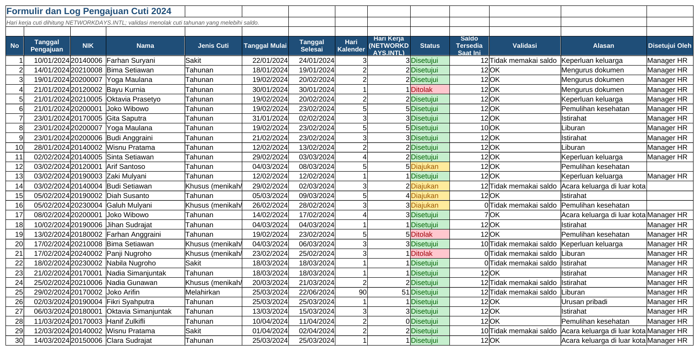

# Tutorial 05: Pengelolaan Cuti (Tingkat Menengah)

File: `05_pengelolaan_cuti.xlsx` | Latihan: [latihan.md](latihan.md) | Kembali ke [README utama](../README.md)

## 1. Tujuan dan hasil akhir

Saya membuat sistem cuti tahunan 2024 untuk 60 karyawan: hak cuti 12 hari, log pengajuan dengan hari kerja yang dihitung NETWORKDAYS.INTL memakai daftar libur nasional, saldo berjalan, validasi yang menolak pengajuan melebihi saldo, rekap per departemen/bulan, dan kalender ringkas yang menampilkan jumlah orang cuti per tanggal.

## 2. Konsep Excel yang dipelajari

- NETWORKDAYS.INTL dengan argumen hari libur
- DATEDIF untuk masa kerja dalam bulan
- SUMIFS dengan rentang yang memanjang (saldo berjalan)
- IF bertingkat untuk validasi
- Data Validation tipe Date (selesai >= mulai)
- DATE, WEEKDAY, MONTH, EOMONTH untuk grid kalender
- COUNTIFS dengan tanggal (`"<="&tgl`)
- Conditional Formatting rumus pada kalender
- TEXT(tanggal;"dddd")

## 3. Struktur workbook

| Sheet | Isi | Rumus kunci |
|---|---|---|
| Hari Libur 2024 | 27 tanggal libur/cuti bersama | `=NETWORKDAYS.INTL(DATE(2024;1;1);DATE(2024;12;31);1;A5:A31)` |
| Saldo Cuti | Hak, terpakai, sisa per karyawan | `=IF(E5>=12;$H$2;0)`, `=SUMIFS('Pengajuan Cuti'!$I$5:$I$500;...;"Disetujui")` |
| Pengajuan Cuti | ±85 pengajuan dengan validasi | `=NETWORKDAYS.INTL(F5;G5;1;'Hari Libur 2024'!$A$5:$A$31)`, `=IF(I5>K5;"MELEBIHI SALDO";"OK")` |
| Rekap Cuti | Per departemen dan per bulan + chart | COUNTIFS/SUMIFS dengan rentang tanggal |
| Kalender | Grid bulan terpilih (C4) dan daftar yang cuti | `=IF(MONTH($C$6+7)=$C$4;$C$6+7;"")`, `=COUNTIFS(mulai;"<="&tgl;selesai;">="&tgl;status;"Disetujui")` |

## 4. Langkah demi langkah dari nol

> Catatan: semua rumus ditulis dengan pemisah titik koma (`;`) untuk Excel regional Indonesia. Pada Excel regional Inggris ganti `;` menjadi `,`.

### Langkah 1: Daftar libur

Sheet Hari Libur 2024: A5:A31 tanggal, B5 `=TEXT(A5;"dddd")`, C keterangan, D5 `=IF(WEEKDAY(A5;2)<=5;"Ya";"Tidak (akhir pekan)")`. WEEKDAY tipe 2: Senin = 1 ... Minggu = 7.

### Langkah 2: Saldo cuti

Sheet Saldo Cuti; H2 = 12 (hak penuh), H3 = 01/01/2024. E5: `=IF(D5>$H$3;0;DATEDIF(D5;$H$3;"M"))` (bulan masa kerja; IF mencegah #NUM! untuk karyawan masuk setelah tanggal acuan). F5: `=IF(E5>=12;$H$2;0)`.

### Langkah 3: Log pengajuan

Sheet Pengajuan Cuti header: No, Tanggal Pengajuan, NIK, Nama, Jenis Cuti, Mulai, Selesai, Hari Kalender, Hari Kerja, Status, Saldo Tersedia, Validasi, Alasan, Disetujui Oleh. D5: `=IFERROR(INDEX('Saldo Cuti'!$B$5:$B$64;MATCH(C5;'Saldo Cuti'!$A$5:$A$64;0));"")`. H5: `=G5-F5+1`.

### Langkah 4: Hari kerja cuti

I5: `=NETWORKDAYS.INTL(F5;G5;1;'Hari Libur 2024'!$A$5:$A$31)`. Argumen ke-3 = 1 berarti akhir pekan Sabtu-Minggu (gunakan 11 untuk hanya Minggu libur); argumen ke-4 daftar libur yang dikecualikan.

### Langkah 5: Saldo berjalan

K5: `=IFERROR(INDEX('Saldo Cuti'!$F$5:$F$64;MATCH(C5;'Saldo Cuti'!$A$5:$A$64;0));0)`. K6: hak cuti dikurangi `SUMIFS($I$5:I5;$C$5:C5;C6;$E$5:E5;"Tahunan";$J$5:J5;"Disetujui")`. Rentang `$I$5:I5` memanjang saat disalin ke bawah sehingga hanya menghitung pengajuan sebelumnya.

### Langkah 6: Validasi

L5: `=IF(E5<>"Tahunan";"Tidak memakai saldo";IF(I5>K5;"MELEBIHI SALDO";IF(F5<B5;"Tanggal mulai sebelum pengajuan";"OK")))`. Conditional Formatting Equal To `MELEBIHI SALDO` merah. Data Validation pada G5:G500: Allow Date, greater than or equal to `=F5`.

### Langkah 7: Cuti terpakai

Kembali ke Saldo Cuti G5: `=SUMIFS('Pengajuan Cuti'!$I$5:$I$500;'Pengajuan Cuti'!$C$5:$C$500;A5;'Pengajuan Cuti'!$E$5:$E$500;"Tahunan";'Pengajuan Cuti'!$J$5:$J$500;"Disetujui")`. I5: `=F5-G5`. Conditional Formatting Less Than 3 pada I.

### Langkah 8: Kalender

Sheet Kalender: C4 bulan (dropdown 1-12), E4 tahun. C5: `=DATE($E$4;$C$4;1)`. C6: `=C5-WEEKDAY(C5;2)+1` (Senin pada minggu pertama). B10: `=IF(MONTH($C$6+0)=$C$4;$C$6+0;"")`, C10 dengan +1, ... sampai H10 (+6); baris 12 mulai +7, dan seterusnya 6 minggu. Format `d`.

### Langkah 9: Jumlah orang cuti per hari

B11: `=IF(B10="";"";COUNTIFS('Pengajuan Cuti'!$F$5:$F$500;"<="&B10;'Pengajuan Cuti'!$G$5:$G$500;">="&B10;'Pengajuan Cuti'!$J$5:$J$500;"Disetujui"))`: hitung pengajuan yang mulai <= tanggal dan selesai >= tanggal. Conditional Formatting rumus `=AND(ISNUMBER(B11);B11>=3)` merah.

### Langkah 10: Rekap

Sheet Rekap Cuti: per departemen SUMIF ke Saldo Cuti; per bulan COUNTIFS/SUMIFS dengan `">="&H14` dan `"<"&I14` (awal bulan dan awal bulan berikut). Chart kolom hari cuti per bulan.

## 5. Kesalahan umum dan cara memperbaikinya

- NETWORKDAYS.INTL mengabaikan libur: rentang libur berisi teks, bukan tanggal.
- Saldo berjalan salah: rentang SUMIFS ditulis `$I$5:$I$500` (semua) bukan `$I$5:I5` (memanjang).
- Kalender menampilkan tanggal bulan lain: lupa membungkus dengan IF(MONTH(...)=$C$4).
- `#NUM!` DATEDIF untuk karyawan baru: tanggal masuk setelah tanggal acuan; tambahkan IF.
- COUNTIFS tanggal mengembalikan 0: tanggal disimpan sebagai teks.

## 6. Latihan tambahan

Kerjakan soal di [latihan.md](latihan.md); kunci jawaban rumus tersedia di bagian bawah file tersebut.

## 7. Variasi untuk tingkat selanjutnya

- Tambahkan cuti yang dibawa dari tahun lalu (carry-over) maksimal 6 hari dengan MIN.
- Gunakan NETWORKDAYS.INTL dengan string akhir pekan `"0000011"` untuk pola shift.
- Buat formulir pengajuan terpisah yang menulis ke log lewat VBA (proyek 10).
