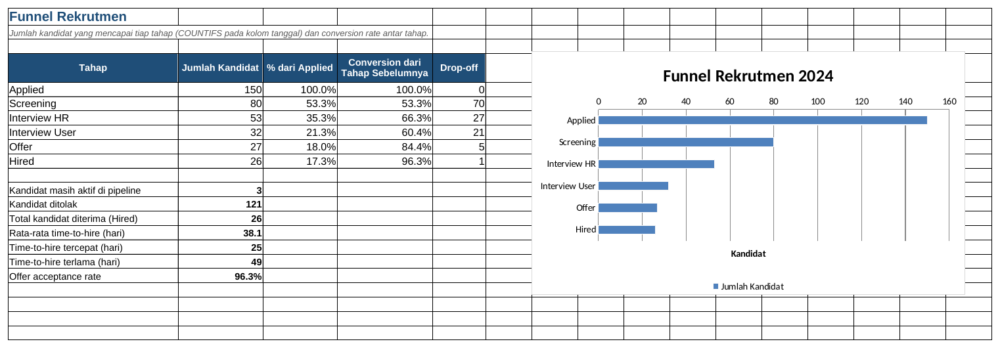

# Tutorial 06: Rekrutmen Tracker (Tingkat Menengah)

File: `06_rekrutmen_tracker.xlsx` | Latihan: [latihan.md](latihan.md) | Kembali ke [README utama](../README.md)

## 1. Tujuan dan hasil akhir

Saya mencatat 150 kandidat yang bergerak di pipeline Applied > Screening > Interview HR > Interview User > Offer > Hired, lalu menghitung funnel dengan COUNTIFS, conversion rate antar tahap, time-to-hire dengan DATEDIF, analisis sumber kandidat, chart funnel, dan panduan klik membuat PivotTable + slicer yang hasilnya dibandingkan dengan sheet ringkasan berbasis rumus.

## 2. Konsep Excel yang dipelajari

- Satu kolom tanggal per tahap (desain data yang ramah rumus)
- COUNTIFS dengan kriteria `"<>"` (tidak kosong)
- IF bertingkat untuk tahap terakhir
- DATEDIF "D" untuk time-to-hire
- AVERAGEIFS, COUNTIFS multi-kriteria
- Conversion rate = tahap n / tahap n-1
- Chart batang horizontal terbalik (funnel)
- PivotTable, Slicer, Timeline, PivotChart (panduan)

## 3. Struktur workbook

| Sheet | Isi | Rumus kunci |
|---|---|---|
| Kandidat | 150 kandidat, 7 kolom tanggal, status | `=IF(K5<>"";"Hired";IF(J5<>"";"Offer";...))`, `=IF(N5="Hired";DATEDIF(F5;K5;"D");"")` |
| Funnel | Jumlah per tahap, conversion, KPI | `=COUNTIFS(Kandidat!$G$5:$G$154;"<>")`, `=IFERROR(B6/B5;0)` |
| Ringkasan Rumus | Per sumber, posisi x tahap, departemen, rekruter, bulan | `=AVERAGEIFS(Kandidat!$O$5:$O$154;Kandidat!$E$5:$E$154;A5;Kandidat!$N$5:$N$154;"Hired")` |
| Panduan Pivot | Langkah klik PivotTable/slicer | - |

## 4. Langkah demi langkah dari nol

> Catatan: semua rumus ditulis dengan pemisah titik koma (`;`) untuk Excel regional Indonesia. Pada Excel regional Inggris ganti `;` menjadi `,`.

### Langkah 1: Desain tabel

Header baris 4: ID Kandidat, Nama, Posisi, Departemen, Sumber, Tanggal Lamar, Tgl Screening, Tgl Interview HR, Tgl Interview User, Tgl Offer, Tgl Hired, Tgl Ditolak, Tahap Terakhir, Status, Time to Hire, Lama di Pipeline, Rekruter. Setiap tahap memiliki kolom tanggal sendiri sehingga funnel cukup menghitung sel terisi.

### Langkah 2: Tahap terakhir

M5: `=IF(K5<>"";"Hired";IF(J5<>"";"Offer";IF(I5<>"";"Interview User";IF(H5<>"";"Interview HR";IF(G5<>"";"Screening";"Applied")))))`. Dicek dari tahap paling akhir ke awal.

### Langkah 3: Time to hire

O5: `=IF(N5="Hired";DATEDIF(F5;K5;"D");"")` (hari dari lamar sampai hired). P5: `=IF(N5="Hired";K5-F5;IF(N5="Rejected";L5-F5;TODAY()-F5))`.

### Langkah 4: Dropdown dan warna

Status: list `Aktif,Hired,Rejected`; Posisi dan Sumber dari sheet Daftar. Conditional Formatting Equal To Hired hijau, Rejected merah, Aktif kuning. Ctrl+T -> `tblKandidat`.

### Langkah 5: Funnel

Sheet Funnel A5:A10 nama tahap. B5: `=COUNTIFS(Kandidat!$F$5:$F$154;"<>")` (Applied = semua yang punya tanggal lamar); B6 kolom G, B7 kolom H, dan seterusnya. C5: `=IFERROR(B5/$B$5;0)`; D6: `=IFERROR(B6/B5;0)` (conversion dari tahap sebelumnya); E6: `=B5-B6` (drop-off).

### Langkah 6: KPI

B15: `=IFERROR(AVERAGE(Kandidat!$O$5:$O$154);0)` (AVERAGE mengabaikan teks kosong). B18 offer acceptance: `=IFERROR(B10/B9;0)`.

### Langkah 7: Chart funnel

Blok A4:B10 > Insert > Bar > Clustered Bar. Klik sumbu vertikal > Format Axis > centang Categories in reverse order agar Applied di atas.

### Langkah 8: Ringkasan per sumber

B5: `=COUNTIF(Kandidat!$E$5:$E$154;A5)`; C5: `=COUNTIFS(Kandidat!$E$5:$E$154;A5;Kandidat!$N$5:$N$154;"Hired")`; D5: `=IFERROR(C5/B5;0)`; G5: `=IFERROR(AVERAGEIFS(Kandidat!$O$5:$O$154;Kandidat!$E$5:$E$154;A5;Kandidat!$N$5:$N$154;"Hired");0)`.

### Langkah 9: Matriks posisi x tahap

B14: `=COUNTIFS(Kandidat!$C$5:$C$154;$A14;Kandidat!$F$5:$F$154;"<>")` lalu ganti kolom F menjadi G, H, I, J, K untuk tahap berikutnya.

### Langkah 10: PivotTable

Ikuti sheet Panduan Pivot: Insert > PivotTable dari tblKandidat; Rows Sumber, Columns Status, Values Count of ID; Insert Slicer Posisi; Insert Timeline Tanggal Lamar. Bandingkan angkanya dengan Ringkasan Rumus; harus sama.

## 5. Kesalahan umum dan cara memperbaikinya

- COUNTIFS `"<>"` menghitung sel berisi spasi: bersihkan dengan Find & Replace.
- DATEDIF `#NUM!`: tanggal hired sebelum tanggal lamar (salah ketik tahun).
- PivotTable tidak berubah setelah data ditambah: klik Refresh.
- Conversion > 100%: tanggal tahap lanjut terisi tetapi tahap sebelumnya kosong; isi berurutan.
- AVERAGE menghasilkan #DIV/0!: belum ada kandidat Hired; bungkus IFERROR.

## 6. Latihan tambahan

Kerjakan soal di [latihan.md](latihan.md); kunci jawaban rumus tersedia di bagian bawah file tersebut.

## 7. Variasi untuk tingkat selanjutnya

- Tambahkan biaya per sumber (cost per hire) dengan SUMIFS/COUNTIFS.
- Hitung SLA tiap tahap (hari antar tahap) dan rata-ratanya dengan AVERAGE pada kolom bantu.
- Buat dashboard rekrutmen dengan slicer terhubung ke beberapa PivotTable (proyek 08).
