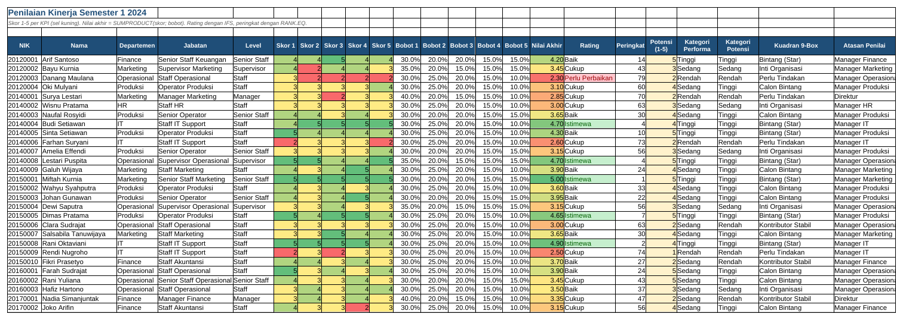

# Tutorial 07: Penilaian Kinerja KPI (Tingkat Menengah)

File: `07_penilaian_kinerja_kpi.xlsx` | Latihan: [latihan.md](latihan.md) | Kembali ke [README utama](../README.md)

## 1. Tujuan dan hasil akhir

Saya membangun sistem penilaian kinerja semester untuk 80 karyawan: lima KPI berbobot per level jabatan, skor 1-5, nilai akhir dengan SUMPRODUCT, rating dengan IFS, peringkat dengan RANK.EQ, kuadran 9-box performa vs potensi dengan INDEX/MATCH dua arah, Conditional Formatting skala warna, serta rekap distribusi rating per departemen dan 10 besar karyawan.

## 2. Konsep Excel yang dipelajari

- SUMPRODUCT untuk rata-rata berbobot
- IFS (dan padanan IF bertingkat)
- RANK.EQ dan peringkat unik
- INDEX/MATCH dua arah (matriks)
- COUNTIFS untuk matriks 9-box dan distribusi
- MAXIFS untuk karyawan terbaik per departemen
- Data Validation whole number 1-5
- Conditional Formatting Color Scale
- Validasi bobot = 100% dengan ROUND

## 3. Struktur workbook

| Sheet | Isi | Rumus kunci |
|---|---|---|
| Master KPI | KPI dan bobot per level, skala skor, batas rating | `=IF(ROUND(L5;4)=1;"OK";"Bobot harus 100%")` |
| Penilaian | 80 karyawan: skor, bobot, nilai akhir, rating, peringkat, 9-box | `=ROUND(SUMPRODUCT(F5:J5;K5:O5);2)`, `=IFS(P5>=4,5;"Istimewa";P5>=3,5;"Baik";P5>=2,5;"Cukup";TRUE;"Perlu Perbaikan")`, `=RANK.EQ(P5;$P$5:$P$84;0)` |
| 9-Box | Label kuadran dan jumlah karyawan per kuadran | `=COUNTIFS(Penilaian!$T$5:$T$84;$B13;Penilaian!$U$5:$U$84;C$12)` |
| Rekap | Distribusi rating per departemen, target distribusi, 10 besar | `=MAXIFS(...)`, `=INDEX(...;MATCH(A22;Penilaian!$X$5:$X$84;0))` |

## 4. Langkah demi langkah dari nol

> Catatan: semua rumus ditulis dengan pemisah titik koma (`;`) untuk Excel regional Indonesia. Pada Excel regional Inggris ganti `;` menjadi `,`.

### Langkah 1: Master KPI

A5:A8 level (Staff, Senior Staff, Supervisor, Manager). Untuk tiap level isi KPI 1-5 (B, D, F, H, J) dan bobot (C, E, G, I, K) dalam persen. L5: `=C5+E5+G5+I5+K5`; M5: `=IF(ROUND(L5;4)=1;"OK";"Bobot harus 100%")`. ROUND menghindari selisih pembulatan biner.

### Langkah 2: Skor

Sheet Penilaian: kolom A-E data karyawan, F-J skor 1-5. Blok F5:J84 > Data Validation > Whole number between 1 and 5. Warnai kuning sebagai sel input.

### Langkah 3: Bobot via INDEX/MATCH

K5: `=INDEX('Master KPI'!$C$5:$C$8;MATCH($E5;'Master KPI'!$A$5:$A$8;0))`; L5 kolom E, M5 kolom G, N5 kolom I, O5 kolom K. Bobot mengikuti level sehingga Manager dan Staff dinilai berbeda.

### Langkah 4: Nilai akhir

P5: `=ROUND(SUMPRODUCT(F5:J5;K5:O5);2)`. SUMPRODUCT mengalikan berpasangan (skor1 x bobot1 + ...) lalu menjumlahkan. Conditional Formatting > Color Scales pada P5:P84.

### Langkah 5: Rating

Q5: `=IFS(P5>=4,5;"Istimewa";P5>=3,5;"Baik";P5>=2,5;"Cukup";TRUE;"Perlu Perbaikan")`. IFS mengevaluasi berurutan; `TRUE` di akhir sebagai default. Excel 2016 pakai `=IF(P5>=4,5;"Istimewa";IF(P5>=3,5;"Baik";IF(P5>=2,5;"Cukup";"Perlu Perbaikan")))`.

### Langkah 6: Peringkat

R5: `=RANK.EQ(P5;$P$5:$P$84;0)` (0 = turun, nilai tertinggi peringkat 1). Kolom bantu X5: `=R5+COUNTIF($P$5:P5;P5)-1` agar peringkat unik untuk INDEX/MATCH.

### Langkah 7: Kategori dan 9-box

T5: `=IF(P5>=4;"Tinggi";IF(P5>=3;"Sedang";"Rendah"))`; U5 sama untuk potensi S5. Sheet 9-Box: B6:B8 performa, C5:E5 potensi, C6:E8 label kuadran. V5: `=INDEX('9-Box'!$C$6:$E$8;MATCH(T5;'9-Box'!$B$6:$B$8;0);MATCH(U5;'9-Box'!$C$5:$E$5;0))`: MATCH pertama mencari baris, kedua mencari kolom.

### Langkah 8: Jumlah per kuadran

9-Box C13: `=COUNTIFS(Penilaian!$T$5:$T$84;$B13;Penilaian!$U$5:$U$84;C$12)`, tarik ke E15. Color Scale pada C13:E15.

### Langkah 9: Rekap

C5: `=COUNTIFS(Penilaian!$C$5:$C$84;$A5;Penilaian!$Q$5:$Q$84;C$4)` tarik ke F10. G5: `=AVERAGEIF(Penilaian!$C$5:$C$84;A5;Penilaian!$P$5:$P$84)`. I5: `=RANK.EQ(G5;$G$5:$G$10;0)`. J5 karyawan terbaik: `=INDEX(Penilaian!$B$5:$B$84;MATCH(MAXIFS(Penilaian!$P$5:$P$84;Penilaian!$C$5:$C$84;A5);Penilaian!$P$5:$P$84;0))`.

### Langkah 10: 10 besar

A22:A31 angka 1-10. B22: `=INDEX(Penilaian!$B$5:$B$84;MATCH(A22;Penilaian!$X$5:$X$84;0))`; salin untuk departemen, nilai, rating. Chart stacked column distribusi rating.

## 5. Kesalahan umum dan cara memperbaikinya

- SUMPRODUCT `#VALUE!`: rentang skor dan bobot tidak sama panjang.
- IFS `#NAME?` di Excel 2016: gunakan IF bertingkat.
- Rating salah karena pemisah desimal: tulis `4,5` di regional Indonesia, `4.5` di Inggris.
- Peringkat kembar membuat INDEX/MATCH mengambil orang yang sama: gunakan kolom peringkat unik.
- Bobot 0,3 diketik 30 (3000%): pastikan format persen dan nilai pecahan.

## 6. Latihan tambahan

Kerjakan soal di [latihan.md](latihan.md); kunci jawaban rumus tersedia di bagian bawah file tersebut.

## 7. Variasi untuk tingkat selanjutnya

- Tambahkan penilaian 360 derajat (atasan, rekan, bawahan) dengan bobot penilai.
- Hitung bonus = gaji x faktor rating via VLOOKUP tabel faktor.
- Gunakan Scatter chart performa vs potensi dengan label nama (Excel 2013+: Data Labels from Cells).
