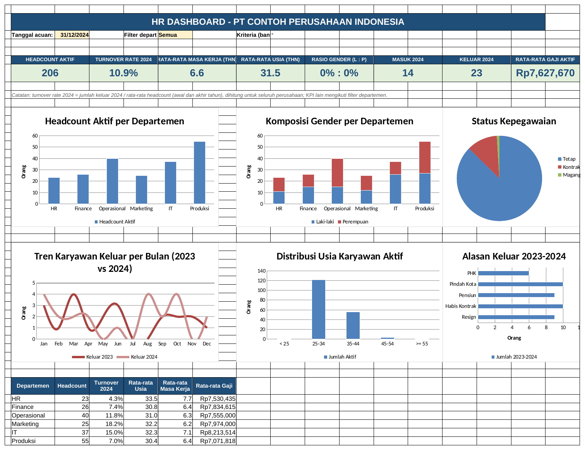

# Tutorial 08: HR Dashboard Analitik (Tingkat Lanjut)

File: `08_hr_dashboard_analitik.xlsx` | Latihan: [latihan.md](latihan.md) | Kembali ke [README utama](../README.md)

## 1. Tujuan dan hasil akhir

Saya merancang dashboard HR satu halaman dari dataset 250 karyawan dan data keluar 2023-2024: kartu KPI (headcount, turnover rate, rata-rata masa kerja, rasio gender, rata-rata usia), chart headcount per departemen, tren keluar bulanan, distribusi usia, filter departemen berbasis dropdown, panduan Power Query untuk menggabungkan dua CSV, panduan slicer/timeline, dan padanan rumus Excel 365.

## 2. Konsep Excel yang dipelajari

- Pemisahan Data - Perhitungan - Dashboard
- COUNTIFS/AVERAGEIFS dengan kriteria wildcard `*` (filter Semua)
- Turnover rate = keluar / rata-rata headcount
- Headcount bulanan dari tanggal masuk dan keluar
- Kartu KPI dengan sel gabungan dan format besar
- Chart kolom, bertumpuk, pie, garis dari tabel bantu
- Power Query: import CSV, tipe data, Merge (Left Outer), Custom Column
- Slicer/Timeline untuk tabel dan PivotTable
- UNIQUE/FILTER/SORT/XLOOKUP/LET (Excel 365) dan padanannya di Excel 2016

## 3. Struktur workbook

| Sheet | Isi | Rumus kunci |
|---|---|---|
| Dashboard | KPI card, 6 chart, tabel ringkas, filter F3 | `=COUNTIFS('Data Karyawan'!$L$5:$L$254;"Aktif";'Data Karyawan'!$F$5:$F$254;$I$3)` dengan I3 = `=IF(F3="Semua";"*";F3)` |
| Data Karyawan | 250 baris, kolom usia/masa kerja/kelompok usia rumus | `=DATEDIF(D5;Dashboard!$C$3;"Y")`, `=ROUND((IF(L5="Aktif";Dashboard!$C$3;M5)-J5)/365,25;1)` |
| Perhitungan | Headcount per dept, usia, level, alasan keluar, turnover bulanan 24 bulan, ringkasan tahunan | `=COUNTIFS(J;"<"&B23)-COUNTIFS(M;"<"&B23)`, `=IFERROR(F23/AVERAGE(D23;G23);0)` |
| Panduan Power Query | Langkah gabung karyawan.csv + turnover_2023_2024.csv | - |
| Panduan Slicer | Slicer, timeline, rumus 365 | - |

## 4. Langkah demi langkah dari nol

> Catatan: semua rumus ditulis dengan pemisah titik koma (`;`) untuk Excel regional Indonesia. Pada Excel regional Inggris ganti `;` menjadi `,`.

### Langkah 1: Dataset

Sheet Data Karyawan: NIK, Nama, JK, Tanggal Lahir, Usia, Departemen, Jabatan, Level, Status Kepegawaian, Tanggal Masuk, Masa Kerja, Status Aktif, Tanggal Keluar, Alasan Keluar, Gaji Pokok, Kota, Kelompok Usia, Tahun Masuk, Tahun Keluar, Pendidikan. Tanggal acuan di Dashboard!C3 (31/12/2024). E5: `=DATEDIF(D5;Dashboard!$C$3;"Y")`. K5: `=ROUND((IF(L5="Aktif";Dashboard!$C$3;M5)-J5)/365,25;1)` (masa kerja berhenti saat keluar). Q5: `=IF(E5<25;"< 25";IF(E5<35;"25-34";IF(E5<45;"35-44";IF(E5<55;"45-54";">= 55"))))`. S5: `=IF(M5="";"";YEAR(M5))`. Ctrl+T -> tblKaryawan.

### Langkah 2: Filter departemen

Dashboard!F3 dropdown `Semua,HR,Finance,Operasional,Marketing,IT,Produksi`. I3: `=IF(F3="Semua";"*";F3)`. Tanda `*` adalah wildcard COUNTIFS yang cocok dengan teks apa pun, sehingga satu rumus melayani filter dan tanpa filter.

### Langkah 3: Kartu KPI

Gabungkan B6:C6 (label) dan B7:C7 (angka), isi warna, font 18. B7: `=COUNTIFS('Data Karyawan'!$L$5:$L$254;"Aktif";'Data Karyawan'!$F$5:$F$254;$I$3)`. F7: `=AVERAGEIFS('Data Karyawan'!$K$5:$K$254;'Data Karyawan'!$L$5:$L$254;"Aktif";'Data Karyawan'!$F$5:$F$254;$I$3)`. Rasio gender: `=TEXT(COUNTIFS(JK;"L";...)/C7;"0%")&" : "&TEXT(COUNTIFS(JK;"P";...)/C7;"0%")`.

### Langkah 4: Tabel bantu per departemen

Sheet Perhitungan A5:A10 departemen. B5: `=COUNTIFS('Data Karyawan'!$F$5:$F$254;A5;'Data Karyawan'!$L$5:$L$254;"Aktif")`; C/D gender; E/F/G status; H usia dan I masa kerja dengan AVERAGEIFS; K5 keluar 2024: `=COUNTIFS('Data Karyawan'!$F$5:$F$254;A5;'Data Karyawan'!$S$5:$S$254;2024)`.

### Langkah 5: Headcount bulanan

Baris 23-46: B tanggal awal bulan, C awal bulan berikut. D23: `=COUNTIFS('Data Karyawan'!$J$5:$J$254;"<"&B23)-COUNTIFS('Data Karyawan'!$M$5:$M$254;"<"&B23)` (sudah masuk dikurangi sudah keluar). E23 masuk: `=COUNTIFS(J;">="&B23;J;"<"&C23)`; F23 keluar sama pada kolom M. G23: `=D23+E23-F23`. H23: `=IFERROR(F23/AVERAGE(D23;G23);0)`.

### Langkah 6: Turnover tahunan

M23: `=D23` (headcount awal 2023), M24: `=G34`, M26 keluar: `=SUM(F23:F34)`, M27: `=AVERAGE(M23;M24)`, M28: `=IFERROR(M26/M27;0)`. Kolom N untuk 2024 (baris 35-46). KPI turnover di Dashboard merujuk N26/N27.

### Langkah 7: Chart

Dari Perhitungan: blok A4:B10 > Insert > Column (headcount). A4:A10 + C4:D10 > Stacked Column (gender). K14:L17 > Pie (status). A48:C60 > Line (keluar 2023 vs 2024). A14:B19 > Column (usia). H14:I19 > Bar (alasan keluar). Potong (Ctrl+X) tiap chart dan tempel di Dashboard, atur ukuran agar sejajar; matikan gridlines (View > Gridlines).

### Langkah 8: Power Query

Ikuti sheet Panduan Power Query: Data > Get Data > From Text/CSV `data/karyawan.csv` (delimiter titik koma), ulangi untuk `data/turnover_2023_2024.csv`, Merge Queries berdasarkan NIK dengan Left Outer, expand kolom TanggalKeluar dan AlasanKeluar, Custom Column StatusAktif `if [TanggalKeluar] = null then "Aktif" else "Keluar"`, Close & Load.

### Langkah 9: Slicer dan timeline

Klik tblKaryawan > Table Design > Insert Slicer (Departemen, Status Aktif). Untuk PivotTable: Insert Timeline Tanggal Masuk. Report Connections untuk menyambungkan beberapa pivot.

### Langkah 10: Versi Excel 365

Ganti tabel bantu dengan `=SORT(UNIQUE(tblKaryawan[Departemen]))` lalu COUNTIFS merujuk hasil tumpahan (`A5#`). Daftar karyawan IT aktif: `=FILTER(tblKaryawan;(tblKaryawan[Departemen]="IT")*(tblKaryawan[Status Aktif]="Aktif"))`. Untuk Excel 2016: daftar unik lewat Data > Remove Duplicates atau PivotTable; FILTER lewat Advanced Filter.

## 5. Kesalahan umum dan cara memperbaikinya

- Headcount awal negatif/salah: tanggal keluar kosong dianggap teks; COUNTIFS `"<"&tanggal` mengabaikan sel kosong, jadi aman, tetapi jangan isi `-`.
- Turnover 2024 berubah saat filter departemen: KPI ini sengaja dihitung total; gunakan kolom L di Perhitungan untuk per departemen.
- Chart kehilangan data setelah dipindah: sumber chart tetap di Perhitungan, jangan hapus sheet itu.
- Power Query gagal baca tanggal: pilih File Origin UTF-8 dan ubah tipe kolom ke Date dengan locale Indonesia.
- Wildcard `*` tidak bekerja untuk angka: untuk kolom numerik gunakan kriteria `"<>"`.

## 6. Latihan tambahan

Kerjakan soal di [latihan.md](latihan.md); kunci jawaban rumus tersedia di bagian bawah file tersebut.

## 7. Variasi untuk tingkat selanjutnya

- Tambahkan KPI biaya gaji per departemen dan rasio span of control.
- Buat versi Power Pivot dengan DAX (`CALCULATE`, `DISTINCTCOUNT`).
- Sambungkan dashboard ke Power BI (lihat repositori analisis penjualan saya).
