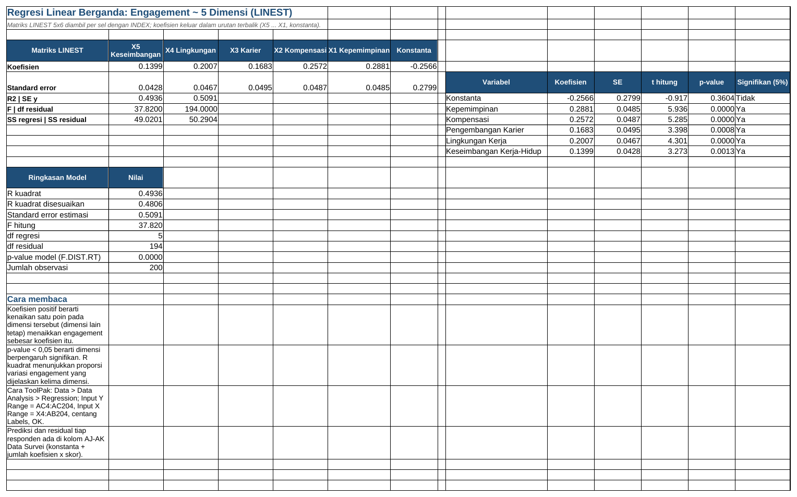

# Tutorial 09: Analisis Survei Engagement dengan Statistika (Tingkat Lanjut)

File: `09_analisis_survei_engagement.xlsx` | Latihan: [latihan.md](latihan.md) | Kembali ke [README utama](../README.md)

## 1. Tujuan dan hasil akhir

Saya menganalisis survei engagement 200 responden (15 item pada 5 dimensi + 3 item engagement, skala 1-5) dengan alat statistika di Excel: statistik deskriptif lengkap dengan interval kepercayaan, matriks korelasi, uji t dua sampel (manual dan T.TEST), ANOVA satu arah (rumus manual dibandingkan Analysis ToolPak), regresi linear berganda dengan LINEST, histogram, dan interpretasi untuk HR. Proyek ini memperlihatkan latar belakang statistika saya.

## 2. Konsep Excel yang dipelajari

- AVERAGE item -> skor dimensi
- COUNT, MEDIAN, MODE.SNGL, STDEV.S, VAR.S, QUARTILE, SKEW, KURT
- Standard error dan CI 95% dengan T.INV.2T
- CORREL dan uji signifikansi r
- T.TEST tipe 2 (varians sama) dan 3 (Welch), t hitung manual, Cohen's d
- ANOVA: SS, df, MS, F dengan SUMPRODUCT dan F.DIST.RT/F.INV.RT
- LINEST 5x6 via INDEX, t dan p koefisien, R2 disesuaikan
- Histogram dengan COUNTIFS (alternatif FREQUENCY)
- Analysis ToolPak (panduan klik)

## 3. Struktur workbook

| Sheet | Isi | Rumus kunci |
|---|---|---|
| Data Survei | 200 responden, 18 item, skor dimensi, kolom bantu ANOVA, prediksi & residual | `=AVERAGE(F5:H5)`, `=IF($B5="HR";$AC5;"")`, `=Regresi!$G$5+Regresi!$F$5*X5+...` |
| Statistik Deskriptif | 15 ukuran x 6 variabel + chart | `=STDEV.S('Data Survei'!$X$5:$X$204)`, `=B6-T.INV.2T(0,05;B5-1)*B17` |
| Korelasi | Matriks 6x6 CORREL, uji r | `=CORREL(x;y)`, `=T.DIST.2T(ABS(B15);198)` |
| Uji t | Tetap vs Kontrak | `=T.TEST(tetap;kontrak;2;2)`, `=B11/SQRT(B12*(1/B5+1/C5))` |
| ANOVA | Engagement antar departemen | `=SUMPRODUCT(B5:B10;(C5:C10-B15)^2)`, `=F.DIST.RT(E18;C18;C19)` |
| Regresi | LINEST, tabel koefisien, ringkasan model | `=INDEX(LINEST(y;x;TRUE;TRUE);1;1)` |
| Histogram | 8 kelas, frekuensi, chart | `=COUNTIFS(y;">="&B5;y;"<"&C5)` |
| Interpretasi | Bacaan untuk HR | - |

## 4. Langkah demi langkah dari nol

> Catatan: semua rumus ditulis dengan pemisah titik koma (`;`) untuk Excel regional Indonesia. Pada Excel regional Inggris ganti `;` menjadi `,`.

### Langkah 1: Skor dimensi

Data Survei: F-W item 1-5 (3 item per dimensi, 3 item engagement). X5: `=AVERAGE(F5:H5)` (Kepemimpinan), Y5 `=AVERAGE(I5:K5)`, ..., AC5: `=AVERAGE(U5:W5)` (Engagement). Urutkan data berdasarkan Status (Tetap dulu) agar tiap kelompok menjadi satu rentang untuk T.TEST.

### Langkah 2: Kolom bantu ANOVA

AD5: `=IF($B5="HR";$AC5;"")`, AE5 Finance, ..., AI5 Produksi. Fungsi COUNT/AVERAGE/VAR.S mengabaikan teks kosong sehingga tiap kolom mewakili satu kelompok.

### Langkah 3: Statistik deskriptif

B5: `=COUNT('Data Survei'!$X$5:$X$204)`, B6 AVERAGE, B7 MEDIAN, B8 `=MODE.SNGL(...)`, B9 `=STDEV.S(...)`, B10 `=VAR.S(...)`, B11 MIN, B12 MAX, B13 `=QUARTILE(...;1)`, B14 `=QUARTILE(...;3)`, B15 SKEW, B16 KURT, B17 `=B9/SQRT(B5)`, B18 `=B6-T.INV.2T(0,05;B5-1)*B17`, B19 `=B6+...`. Salin ke kolom C-G untuk dimensi lain. STDEV.S membagi n-1 (sampel).

### Langkah 4: Korelasi

B5: `=CORREL('Data Survei'!$X$5:$X$204;'Data Survei'!$X$5:$X$204)` dan seterusnya membentuk matriks 6x6; Color Scale. Uji r: t = `=B14*SQRT(200-2)/SQRT(1-B14^2)`, p = `=T.DIST.2T(ABS(B15);198)`.

### Langkah 5: Uji t

Rentang Tetap = AC5:AC(n_tetap+4), Kontrak sisanya. B5 `=COUNT(tetap)`, B6 AVERAGE, B7 VAR.S. B12 pooled: `=((B5-1)*B7+(C5-1)*C7)/(B5+C5-2)`. B13: `=B11/SQRT(B12*(1/B5+1/C5))`. B16: `=T.DIST.2T(ABS(B13);B14)`. B17: `=T.TEST(tetap;kontrak;2;2)` (ekor = 2, tipe 2 = varians sama; tipe 3 = Welch). Keputusan: `=IF(B17<B10;"Tolak H0";"Gagal tolak H0")`.

### Langkah 6: ANOVA manual

B5: `=COUNT('Data Survei'!$AD$5:$AD$204)`, C5 AVERAGE, D5 VAR.S, E5 SUM per departemen. B15 grand mean `=SUM(E5:E10)/B13`. SS antar: `=SUMPRODUCT(B5:B10;(C5:C10-B15)^2)`; SS dalam: `=SUMPRODUCT(B5:B10-1;D5:D10)`; df = k-1 dan N-k; MS = SS/df; F = MS antar/MS dalam; p = `=F.DIST.RT(E18;C18;C19)`; F tabel = `=F.INV.RT(0,05;C18;C19)`. Eta kuadrat = SS antar/SS total.

### Langkah 7: ANOVA ToolPak

File > Options > Add-ins > Go > centang Analysis ToolPak. Data > Data Analysis > Anova: Single Factor; Input Range AD4:AI204 (Grouped by Columns, Labels in first row), Alpha 0,05, Output di sel kosong. Angkanya harus identik dengan tabel manual.

### Langkah 8: Regresi LINEST

B5: `=INDEX(LINEST('Data Survei'!$AC$5:$AC$204;'Data Survei'!$X$5:$AB$204;TRUE;TRUE);1;1)` dan ubah indeks baris 1-5, kolom 1-6 untuk sel lain. Baris 1 koefisien (urutan terbalik: X5, X4, ..., X1, konstanta), baris 2 SE, baris 3 R2 dan SE y, baris 4 F dan df residual, baris 5 SS regresi dan SS residual. t = koefisien/SE, p = `=T.DIST.2T(ABS(t);df)`. R2 adj = `=1-(1-R2)*(n-1)/(n-k-1)`.

### Langkah 9: Prediksi dan residual

Data Survei AJ5: `=Regresi!$G$5+Regresi!$F$5*X5+Regresi!$E$5*Y5+Regresi!$D$5*Z5+Regresi!$C$5*AA5+Regresi!$B$5*AB5`; AK5: `=AC5-AJ5`. Residual dapat diplot untuk memeriksa asumsi.

### Langkah 10: Histogram

Batas kelas B5:C12 (1,0-1,5; ...; 4,5-5,0). D5: `=COUNTIFS('Data Survei'!$AC$5:$AC$204;">="&B5;'Data Survei'!$AC$5:$AC$204;"<"&C5)`. E5: `=D5/SUM($D$5:$D$12)`. Chart Column, Gap Width 10%. Alternatif: `=FREQUENCY(data;batas_atas)` sebagai rumus array.

## 5. Kesalahan umum dan cara memperbaikinya

- T.TEST `#N/A`: rentang mengandung teks atau kosong; pastikan kelompok adalah rentang angka murni (data terurut).
- LINEST hanya menampilkan satu angka: di Excel lama blok 5x6 lalu Ctrl+Shift+Enter, atau pakai INDEX seperti di sini.
- Koefisien tertukar: LINEST mengembalikan koefisien dari variabel terakhir ke pertama.
- VAR.S vs VAR.P: gunakan .S untuk sampel survei.
- ANOVA manual beda dengan ToolPak: ada sel kosong yang terisi spasi sehingga COUNT berbeda.

## 6. Latihan tambahan

Kerjakan soal di [latihan.md](latihan.md); kunci jawaban rumus tersedia di bagian bawah file tersebut.

## 7. Variasi untuk tingkat selanjutnya

- Uji asumsi: normalitas residual (histogram, Q-Q), homogenitas varians (uji Levene manual).
- Regresi logistik untuk memprediksi niat resign (butuh Solver atau R).
- Analisis reliabilitas Cronbach's alpha per dimensi: `=k/(k-1)*(1-SUM(var_item)/var_total)`.
