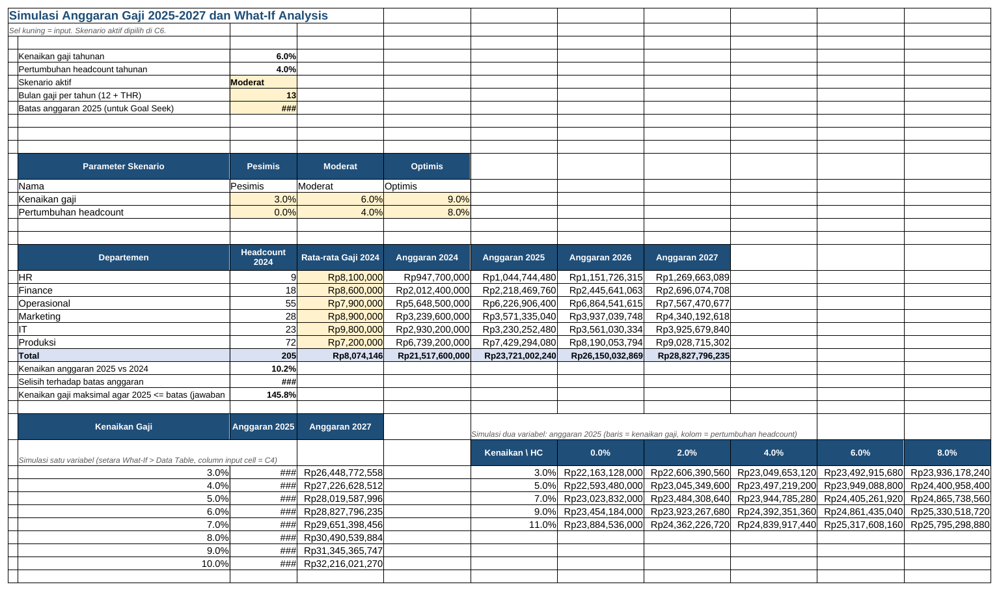

# Tutorial 10: Perencanaan Tenaga Kerja dan Otomasi (Tingkat Lanjut)

File: `10_perencanaan_tenaga_kerja.xlsx` | Latihan: [latihan.md](latihan.md) | Kembali ke [README utama](../README.md)

## 1. Tujuan dan hasil akhir

Saya memproyeksikan headcount 2025-2027 per departemen dari data 2019-2024 dengan FORECAST.LINEAR, TREND, dan CAGR, menghitung kebutuhan rekrutmen, menyimulasikan anggaran gaji dengan skenario kenaikan persen, lalu melatih What-If Analysis (Data Table satu dan dua variabel, Goal Seek, Scenario Manager). Modul VBA di folder `vba/` mengotomatiskan slip gaji PDF massal, rekap per departemen, dan validasi data.

## 2. Konsep Excel yang dipelajari

- FORECAST.LINEAR dan TREND (regresi linear sederhana)
- CAGR dengan pangkat pecahan
- MAX untuk kebutuhan rekrutmen non-negatif
- Model anggaran dengan parameter terpusat dan skenario INDEX/MATCH
- Data Table 1 dan 2 variabel (What-If)
- Goal Seek dan jawaban analitik
- Scenario Manager dan Summary
- SUMPRODUCT + COUNTIF untuk duplikat, COUNTBLANK
- VBA: Dictionary, loop, ExportAsFixedFormat, Worksheets.Add

## 3. Struktur workbook

| Sheet | Isi | Rumus kunci |
|---|---|---|
| Historis | Headcount 2019-2024 per departemen, CAGR, tahun numerik | `=(G5/B5)^(1/5)-1` |
| Proyeksi | FORECAST.LINEAR, TREND, CAGR, kebutuhan rekrutmen | `=ROUND(FORECAST.LINEAR(2025;Historis!$B$5:$G$5;Historis!$B$13:$G$13);0)`, `=ROUND(TREND(y;x;2026);0)` |
| Anggaran Gaji | Skenario, model 2025-2027, simulasi setara Data Table, Goal Seek | `=INDEX(C14:E14;MATCH(C6;C13:E13;0))`, `=E19*(1+$C$4)*(1+$C$5)`, `=C8/E25/(1+C5)-1` |
| Data Karyawan | 120 baris bahan uji makro (3 masalah disengaja) | `=SUMPRODUCT((COUNTIF(A5:A124;A5:A124)>1)*1)` |
| Panduan What-If & VBA | Langkah klik | - |

## 4. Langkah demi langkah dari nol

> Catatan: semua rumus ditulis dengan pemisah titik koma (`;`) untuk Excel regional Indonesia. Pada Excel regional Inggris ganti `;` menjadi `,`.

### Langkah 1: Data historis

Historis!A5:A10 departemen, B4:G4 tahun sebagai teks header, B13:G13 tahun sebagai angka (2019...2024) untuk sumbu x. H5 CAGR: `=(G5/B5)^(1/5)-1`.

### Langkah 2: FORECAST.LINEAR

Proyeksi!C5: `=ROUND(FORECAST.LINEAR(2025;Historis!$B$5:$G$5;Historis!$B$13:$G$13);0)`. Argumen: x baru, known_y (headcount), known_x (tahun). Excel 2013 ke bawah: gunakan `FORECAST`. D5 untuk 2026, E5 untuk 2027.

### Langkah 3: TREND

F5: `=ROUND(TREND(Historis!$B$5:$G$5;Historis!$B$13:$G$13;2025);0)`; hasil sama dengan FORECAST.LINEAR tetapi TREND dapat mengembalikan beberapa nilai sekaligus (array).

### Langkah 4: CAGR dan kebutuhan rekrutmen

I5: `=ROUND(B5*(1+Historis!H5)^3;0)`. Kebutuhan 2025 (baris 16-21): pengganti turnover `=ROUND(B16*$B$13;0)` (B13 = asumsi turnover 12%), penambahan baru `=MAX(C5-B5;0)`, total = keduanya.

### Langkah 5: Model anggaran

Anggaran Gaji!C13:E15 tabel skenario (nama, kenaikan gaji, pertumbuhan headcount). C6 dropdown skenario; C4: `=INDEX(C14:E14;MATCH(C6;C13:E13;0))`, C5 serupa. E19: `=C19*D19*$C$7` (headcount x gaji rata-rata x 13 bulan). F19: `=E19*(1+$C$4)*(1+$C$5)`, G19 dari F19, H19 dari G19. Total baris 25.

### Langkah 6: Data Table satu variabel

B32:B39 kenaikan 3%-10%. Versi rumus eksplisit: C32 `=$E$25*(1+B32)*(1+$C$5)`. Versi Excel asli: di C31 ketik `=F25`, blok B31:C39, Data > What-If Analysis > Data Table, Column input cell C4, OK; Excel mengisi `{=TABLE(;C4)}` yang menghitung ulang model untuk tiap nilai.

### Langkah 7: Data Table dua variabel

F31 sel sudut berisi `=F25`; G31:K31 pertumbuhan headcount; F32:F36 kenaikan gaji. Blok F31:K36 > Data Table > Row input cell C5, Column input cell C4. Versi rumus: `=$E$25*(1+$F32)*(1+G$31)`.

### Langkah 8: Goal Seek

Data > What-If Analysis > Goal Seek: Set cell F25, To value = nilai C8 (batas anggaran), By changing cell C4. Excel mencari kenaikan gaji yang memenuhi batas. Jawaban analitiknya: C28 `=C8/E25/(1+C5)-1`.

### Langkah 9: Scenario Manager

Data > What-If Analysis > Scenario Manager > Add: nama Pesimis, Changing cells C4:C5, nilai 3% dan 0%; ulangi Moderat (6%, 4%) dan Optimis (9%, 8%). Show untuk menerapkan; Summary dengan Result cells F25:H25 menghasilkan laporan perbandingan.

### Langkah 10: Pasang makro VBA

Alt+F11 > File > Import File > pilih `vba/ValidasiData.bas`, `vba/RekapPerDepartemen.bas` (untuk file ini) dan `vba/SlipGajiPDF.bas` (untuk file proyek 04). Save As tipe Excel Macro-Enabled Workbook (.xlsm). Developer > Macros > Run. ValidasiData menemukan 3 masalah yang sengaja ditanam (NIK ganda baris 40, email kosong baris 61, gaji di bawah UMK baris 85); RekapPerDepartemen membuat 6 sheet; SlipGajiPDF mengekspor 70 PDF ke folder slip_pdf.

## 5. Kesalahan umum dan cara memperbaikinya

- FORECAST.LINEAR `#NAME?` di Excel 2013: gunakan FORECAST.
- Proyeksi negatif untuk departemen menyusut: batasi dengan MAX(...;0).
- Data Table tidak berubah: Formulas > Calculation Options harus Automatic (bukan Automatic except for data tables).
- Goal Seek tidak konvergen: sel pengubah mengandung rumus (C4 dari INDEX); ketik angka dulu atau ubah ke sel input.
- Makro tidak muncul: file masih .xlsx atau makro dinonaktifkan di Trust Center.

## 6. Latihan tambahan

Kerjakan soal di [latihan.md](latihan.md); kunci jawaban rumus tersedia di bagian bawah file tersebut.

## 7. Variasi untuk tingkat selanjutnya

- Tambahkan proyeksi musiman dengan FORECAST.ETS untuk data bulanan.
- Gunakan Solver untuk mengalokasikan tambahan headcount dengan batas anggaran.
- Kembangkan makro menjadi UserForm input karyawan baru.
