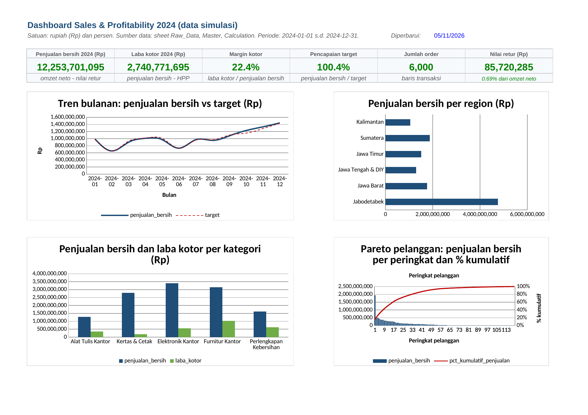

# Sales & Profitability Analysis

**Proyek portofolio dengan data simulasi**

Saya membangun analisis penjualan dari transaksi, diskon, retur, dan master biaya sampai dashboard profitabilitas yang dapat ditelusuri rumusnya. Saya membandingkan hasil dengan target per region, margin kategori, serta konsentrasi pelanggan untuk menyusun rekomendasi bersyarat. Saya memeriksa workbook dengan recalculation LibreOffice dan rekonsiliasi independen pandas, termasuk setiap bulan dan komponen per transaksi.

Data pada proyek ini adalah data sintetis yang saya bangkitkan dengan skrip; tidak ada data perusahaan atau pribadi nyata.

## Masalah bisnis dan pertanyaan analisis

Dalam simulasi distributor perlengkapan kantor, penjualan besar belum tentu menghasilkan laba kotor yang sebanding. Diskon, retur, biaya produk, dan bauran pelanggan memengaruhi hasil. Saya ingin menjawab:

- Bagaimana tren omzet bruto, penjualan bersih, HPP, dan laba kotor sepanjang periode?
- Region mana yang mencapai target, dan seberapa besar kontribusinya?
- Kategori mana yang marginnya paling rendah setelah diskon dan retur?
- Berapa bagian penjualan yang bergantung pada pelanggan teratas?

Periode data adalah tahun 2024. Satu baris mewakili satu order dengan satu produk, bukan satu invoice multi-produk. Data mencakup 6.000 order, 120 retur, serta master produk, pelanggan, wilayah, salesperson, dan target. Jumlah tersebut berasal dari CSV yang diperiksa verifier.

## Membuka dan memeriksa workbook

1. Unduh [solusi](workbook/solusi_sales_profitability.xlsx) atau [latihan](workbook/latihan_sales_profitability.xlsx) menggunakan tombol download GitHub. Preview halaman GitHub tidak menghitung rumus.
2. Baca sheet `Readme` pada solusi atau `Instruksi` pada latihan. Pilih **Formulas > Calculation Options > Automatic**, lalu tekan **Ctrl+Alt+F9** di Excel.
3. Buka `Report` untuk dashboard, `Calculation` untuk rekap, `Raw_Data` untuk transaksi dan rumus per order, `Retur` untuk retur, serta `Master` untuk referensi dan target.
4. Buka `Checks`; semua pemeriksaan solusi harus PASS. Pada latihan, sel kuning sengaja kosong dan status awalnya BELUM DIISI.
5. Cocokkan angka dengan [VERIFIKASI.md](VERIFIKASI.md). Untuk berlatih dari awal, ikuti [instruksi pengerjaan](docs/instruksi_pengerjaan.md).

Rumus dalam dokumen memakai titik koma untuk Excel regional Indonesia; regional Inggris memakai koma. File menyimpan nama fungsi Inggris dan koma sesuai format internal XLSX.

## Hasil utama

| KPI tahunan | Hasil |
|---|---:|
| Omzet bruto | Rp14.074.330.000 |
| Penjualan bersih | Rp12.253.701.095 |
| HPP neto retur | Rp9.512.929.400 |
| Laba kotor | Rp2.740.771.695 |
| Margin kotor | 22,37% |
| Pencapaian target keseluruhan | 100,40% |
| Kontribusi 20% pelanggan teratas | 71,56% |

Angka berasal dari workbook hasil recalc dan pandas; selisih rekonsiliasi moneter nol setelah pembulatan dua desimal. Margin dihitung dari total laba dibagi total penjualan, bukan rata-rata margin order. Definisi, grain, dan konvensi pembagi nol ada di [definisi KPI](docs/definisi_kpi.md).

### Target per region

| Region | Penjualan bersih (Rp) | Target (Rp) | Pencapaian |
|---|---:|---:|---:|
| Jabodetabek | 4.758.516.825 | 4.454.000.000 | 106,84% |
| Jawa Barat | 1.763.168.180 | 1.733.000.000 | 101,74% |
| Jawa Tengah & DIY | 1.298.545.720 | 1.378.000.000 | 94,23% |
| Jawa Timur | 1.511.206.095 | 1.497.000.000 | 100,95% |
| Sumatera | 1.871.749.140 | 2.022.000.000 | 92,57% |
| Kalimantan | 1.050.515.135 | 1.121.000.000 | 93,71% |

### Kategori dan konsentrasi

| Kategori | Penjualan bersih (Rp) | Margin kotor |
|---|---:|---:|
| Alat Tulis Kantor | 1.281.540.780 | 27,76% |
| Kertas & Cetak | 2.801.169.230 | 6,73% |
| Elektronik Kantor | 3.406.565.790 | 16,16% |
| Furnitur Kantor | 3.150.905.750 | 32,65% |
| Perlengkapan Kebersihan | 1.613.519.545 | 38,24% |

Kategori dengan margin terendah adalah **Kertas & Cetak (6,73%)**. Sebanyak **24 pelanggan**, yaitu 20% dari master pelanggan, menyumbang **71,56%** penjualan bersih. Ini hasil pengurutan aktual simulasi, bukan asumsi bahwa aturan Pareto harus tepat 80/20.

## Temuan dan rekomendasi

Saya memprioritaskan peninjauan diskon dan bauran produk pada kategori bermargin tipis, pembahasan kewajaran target region, serta risiko konsentrasi pelanggan. Saya tidak langsung menyimpulkan bahwa diskon menyebabkan penjualan naik atau bahwa praktik suatu region pasti dapat disalin. Pola data sengaja dibangkitkan; tindakan yang masuk akal perlu diuji pada data operasional dan target independen.

Rincian angka, alasan, rekomendasi, dan ukuran pemantauan tersedia di [temuan dan rekomendasi](docs/temuan_rekomendasi.md). [Panduan wawancara](docs/panduan_wawancara.md) menjelaskan cara saya menunjukkan alur dan keterbatasan tanpa mengklaim pengalaman kerja nyata.

## Preview dari workbook



[PDF dashboard](assets/report.pdf) dan PNG di atas berasal dari render nyata LibreOffice atas sheet Report, kemudian konversi PDF ke PNG dengan pdftoppm. Angka dan grafiknya merujuk workbook; gambar bukan dashboard yang digambar terpisah.

## Data dan pembangunan ulang

- [Kamus data](data/data_dictionary.md): skema, kunci, tipe data, relasi, dan satuan.
- [Cleaning dan transformasi](docs/cleaning_transformasi.md): pemeriksaan dan pembentukan KPI.
- [Pemeriksaan kualitas](docs/pemeriksaan_kualitas.md): metode rekonsiliasi dan kontrol.
- [PivotTable manual](docs/pivot_table.md) dan [Power Query](docs/power_query.md), dengan [skrip M](pq/transaksi.pq).
- [Rekonsiliasi CSV](data/processed/rekonsiliasi.csv) dan [ringkasan terstruktur](data/processed/ringkasan.json).

Jalankan dari folder proyek dengan Python, dependensi pada requirements.txt, LibreOffice headless, dan pdftoppm:

```bash
python -m pip install -r requirements.txt
python tools/generate_data.py
python tools/build_workbook.py
python tools/verify.py
```

Seed tetap ada pada generator. Semua CSV berhasil dibangkitkan ulang identik dengan bahan awal. Builder membuat ulang latihan dan solusi; verifier menghitung ulang kedua file, memeriksa formula, lalu menulis bukti rekonsiliasi dan preview. Pembangunan ulang mengganti workbook, sehingga perubahan manual perlu disimpan di salinan. Jika LibreOffice gagal, hasil baru belum boleh disebut terverifikasi.

## Keterbatasan analisis dan tool

Target dibangkitkan dari realisasi simulasi dengan faktor ambisi dan gangguan acak, sehingga pencapaian bukan evaluasi independen kinerja tim. Biaya satuan konstan, barang retur dianggap pulih sepenuhnya, dan retur diatribusikan ke bulan order. Pajak, logistik, biaya operasional, piutang, persediaan, dan laba bersih tidak dihitung. Musiman dan bauran kategori dirancang dalam generator; tidak ada kesimpulan sebab-akibat.

Chart native dan rumus hidup tersedia, tetapi PivotTable, PivotChart, Slicer, Timeline, dan koneksi Power Query belum tertanam. Saya menyediakan panduan manual dan pembanding Calculation. Skrip M belum dieksekusi di mesin Power Query. Recalculation dijalankan di LibreOfficeDev; tampilan dan interaksi pada Excel 2016/2019/365 perlu diperiksa saat dibuka. Google Sheets dapat mengubah chart atau format saat impor; hasil impor belum menjadi bagian verifikasi ini.

## Asal bahan dan perubahan

Saya melanjutkan bahan `_bahan-lanjutan/proyek/01_sales_profitability/` pada branch `bahan-lanjutan`, commit `7f1aa84be60944e96133e78945c3f0f189631774`, melalui branch kerja dari main `5bdc480463477456c1658a6b35778bbf7b2aaaf3`. Generator serta builder dijalankan ulang. Saya mengganti rumus peringkat yang tidak diizinkan, menghindari penambahan pecahan pada uang, membuat pembanding Checks tetap berumus, memperjelas pembagi nol dan latihan kosong, serta menambahkan verifikasi, dokumentasi, dan render. Proyek HR dan modul dasar tidak diubah.
