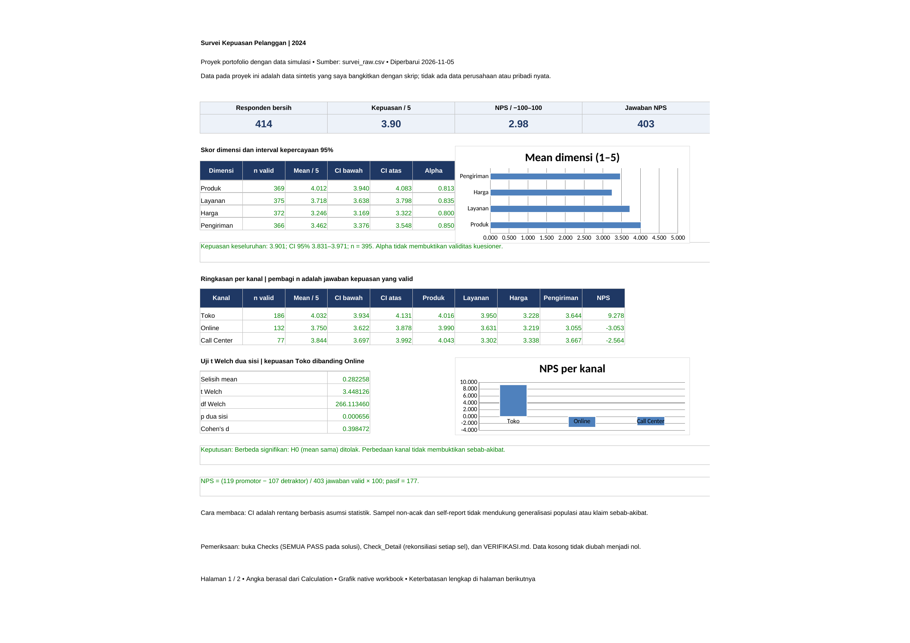
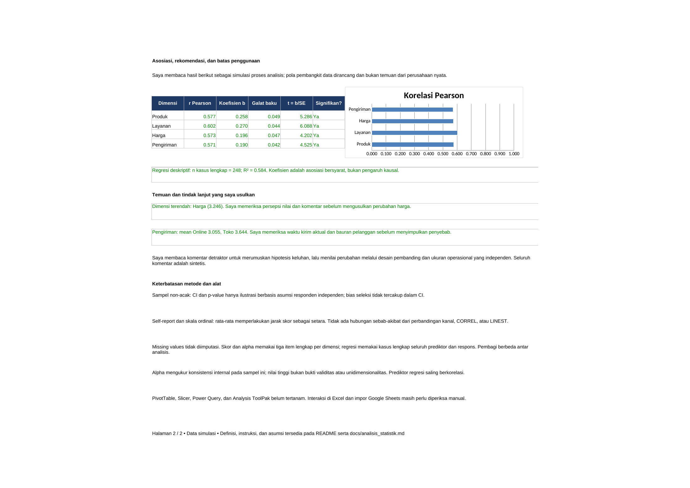

# Survei Kepuasan Pelanggan

**Proyek portofolio dengan data simulasi**

Saya membangun alur survei dari data mentah bermasalah sampai laporan kepuasan, NPS, dan konsistensi internal kuesioner dengan rumus yang dapat ditelusuri. Saya membandingkan empat dimensi serta kanal dengan CI, uji t Welch, korelasi, dan regresi deskriptif, sambil menjelaskan asumsi dan batas inferensinya. Saya memeriksa hasil melalui recalc LibreOffice, rekonsiliasi setiap sel bersih, dan perhitungan independen pandas/scipy.

Data pada proyek ini adalah data sintetis yang saya bangkitkan dengan skrip; tidak ada data perusahaan atau pribadi nyata.

## Masalah bisnis dan pertanyaan analisis

Dalam simulasi penjualan multikanal, ringkasan kepuasan dapat menyesatkan jika duplikat, nilai kosong, dan skor salah input langsung dirata-ratakan. Saya ingin mengetahui dimensi mana yang dinilai paling rendah, apakah kepuasan Toko dan Online berbeda dalam sampel, bagaimana distribusi NPS, serta seberapa konsisten tiga item dalam setiap dimensi.

Periode data adalah 2024. Satu baris mentah adalah satu catatan survei; terdapat 420 catatan dan 414 ID responden unik. Enam salinan identik dibuang melalui penanda `dipakai`, tanpa menghapus jejak baris di workbook. Sampel ini mensimulasikan pengisian sukarela non-acak; angka tidak mewakili populasi pelanggan nyata.

## Membuka dan memeriksa workbook

1. Unduh [solusi](workbook/solusi_survei_kepuasan_pelanggan.xlsx) atau [latihan](workbook/latihan_survei_kepuasan_pelanggan.xlsx) melalui tombol download GitHub. Preview GitHub tidak menghitung rumus.
2. Baca sheet `Readme`; latihan juga memiliki `Instruksi`. Pilih **Formulas > Calculation Options > Automatic**, lalu tekan **Ctrl+Alt+F9**.
3. Baca `Codebook` dan parameter `Master`, lalu bandingkan `Raw_Data` dengan kolom berumus pada `Clean_Data`. Filter `dipakai = 1` untuk melihat responden unik.
4. Buka `Calculation`, `Report`, dan `Checks`. Pada solusi seluruh pemeriksaan harus PASS. `Reference` menyimpan salinan CSV pembanding; `Check_Detail` mencocokkan setiap sel. `Analisis_Set` menumpuk kasus lengkap bagi CORREL/LINEST.
5. Cocokkan hasil dengan [VERIFIKASI.md](VERIFIKASI.md), kemudian ikuti [instruksi pengerjaan](docs/instruksi_pengerjaan.md). Sel kuning latihan sengaja kosong; statusnya BELUM DIISI.

Rumus dalam dokumen memakai titik koma untuk Excel regional Indonesia; Excel regional Inggris memakai koma. File menyimpan nama fungsi Inggris dan koma sesuai format internal XLSX.

## Hasil utama

| Dimensi | n valid | Mean (1–5) | CI 95% | Alpha |
|---|---:|---:|---|---:|
| Produk | 369 | 4,012 | 3,940–4,083 | 0,813 |
| Layanan | 375 | 3,718 | 3,638–3,798 | 0,835 |
| Harga | 372 | 3,246 | 3,169–3,322 | 0,800 |
| Pengiriman | 366 | 3,462 | 3,376–3,548 | 0,850 |

Skor dimensi adalah mean tiga item hanya saat ketiganya valid; n dan alpha memakai responden yang sama pada dimensi tersebut. Tidak ada imputasi. Kepuasan keseluruhan adalah satu item terpisah: mean **3,901**, CI 95% **3,831–3,971**, n = **395**.

NPS adalah **+2,98** pada skala −100 sampai +100, dari **403** jawaban valid: **119 promotor**, **177 pasif**, dan **107 detraktor**. Nilai NPS bukan rata-rata skor rekomendasi.

Uji t Welch dua sisi pada kepuasan keseluruhan: Toko **4,032** (n=186) dibanding Online **3,750** (n=132); selisih **0,282** poin, t = **3,448**, df = **266,113**, p = **0,00065603**, Cohen's d = **0,398**. Pada taraf 0,05 H0 mean sama ditolak, bersyarat pada asumsi uji. Ini tidak membuktikan kanal menyebabkan perbedaan kepuasan.

CORREL dan LINEST memakai **248 kasus lengkap**, dengan R² deskriptif **0,584**. Koefisien serta galat baku tersedia di workbook dan [analisis statistik](docs/analisis_statistik.md).

## Temuan dan rekomendasi

Harga memiliki mean dimensi terendah. Saya mengusulkan pemeriksaan persepsi nilai, komentar, dan bauran segmen sebelum perubahan harga. Pengiriman Online perlu ditinjau bersama data waktu kirim aktual. NPS yang positif tipis tidak cukup untuk menyatakan loyalitas pelanggan membaik tanpa gelombang pembanding.

Alpha berada pada rentang **0,800–0,850**. Angka ini menunjukkan konsistensi internal pada data simulasi, bukan bukti validitas konstruk atau unidimensionalitas. Rincian tindakan bersyarat dan ukuran pemantauan ada di [temuan dan rekomendasi](docs/temuan_rekomendasi.md).

## Preview dari workbook





[PDF laporan](assets/report.pdf) dan PNG berasal dari render nyata sheet Report dengan LibreOffice, lalu pdftoppm. Grafik adalah chart native yang merujuk sel workbook.

## Data dan pembangunan ulang

- [Codebook](codebook.md) dan [kamus data](data/data_dictionary.md).
- [Masalah kualitas data](docs/masalah_kualitas_data.md), [cleaning dan transformasi](docs/cleaning_transformasi.md), serta [definisi KPI](docs/definisi_kpi.md).
- [Analisis statistik](docs/analisis_statistik.md), [pemeriksaan kualitas](docs/pemeriksaan_kualitas.md), dan [panduan wawancara](docs/panduan_wawancara.md).
- [Rekonsiliasi](data/processed/rekonsiliasi.csv), [ringkasan dan hash](data/processed/ringkasan.json), serta [koreksi tanggal referensi](data/processed/koreksi_tanggal_referensi.csv).

Jalankan dari folder proyek dengan Python, dependensi pada requirements.txt, LibreOffice headless (`soffice`), `pdfinfo`, dan `pdftoppm` pada PATH:

```bash
python -m pip install -r requirements.txt
python tools/generate_data.py
python tools/build_workbook.py
python tools/verify.py
```

Seed generator tetap. Pembangunan ulang mengganti kedua workbook; simpan pekerjaan manual pada salinan. Verifier selalu menjalankan recalc baru dan berhenti jika mesin tidak tersedia atau pemeriksaan gagal. Bukti lama tidak berlaku untuk workbook baru yang belum diverifikasi.

## Keterbatasan analisis dan tool

Sampel non-acak dan jawaban self-report membatasi generalisasi. Skala ordinal diperlakukan mendekati interval saat menghitung mean, CI, dan regresi. Responden diasumsikan independen; CI dan p-value tidak mengoreksi bias seleksi, nonrespons, atau kesalahan pengukuran. Tidak ada hubungan sebab-akibat yang dapat ditetapkan. Missing values menurunkan n dengan pola berbeda antar analisis; regresi hanya memakai kasus lengkap. Pola antarkanal dirancang dalam generator.

PivotTable, Slicer, Timeline, Power Query, Data Model, dan Analysis ToolPak belum tertanam. Saya menyediakan alur rumus pembanding dan langkah manual statistik; tidak ada klaim fitur tersebut sudah dijalankan. Rumus tidak memakai dynamic array; tampilan/interaksi Excel 2016/2019/365 dan hasil impor Google Sheets belum diuji. Mesin recalc dan hasil nyata dicatat di VERIFIKASI.md.

## Asal bahan dan perubahan

Saya melanjutkan bahan survei pada branch `bahan-lanjutan`, commit `7f1aa84be60944e96133e78945c3f0f189631774`, melalui branch kerja dari main `3538c023095c9fb7af861960bf58d7a2f654219a`. CSV mentah dibangkitkan ulang identik dengan sumber. Saya memperbaiki parser tanggal pada referensi (133 tanggal ISO sebelumnya tertukar bulan/hari), memperjelas hitungan masalah sebelum/sesudah duplikasi, mempertahankan teks mentah, menambahkan rekonsiliasi per sel, dan menyelesaikan latihan, dokumentasi, serta render. Proyek Sales, HR, dan modul dasar dipertahankan.
