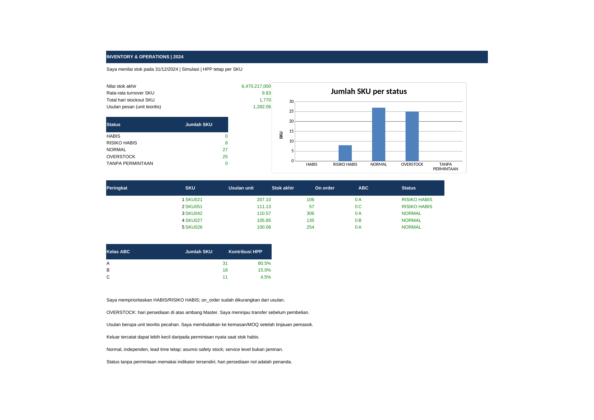

# Inventory & Operations

**Proyek portofolio dengan data simulasi**

Saya membangun alur inventori dari buku pergerakan dan purchase order sampai stok harian, klasifikasi ABC, serta usulan pemesanan dengan rumus hidup. Saya menghubungkan risiko habis, overstock, dan turnover ke daftar tinjauan operasional sambil menyatakan periode serta asumsi tiap KPI. Saya memeriksa kedua workbook melalui penghitungan ulang LibreOffice dan rekonsiliasi independen pandas/scipy untuk seluruh kisi harian serta KPI per SKU.

Data pada proyek ini adalah data sintetis yang saya bangkitkan dengan skrip; tidak ada data perusahaan atau pribadi nyata.

## Masalah bisnis dan pertanyaan analisis

Dalam simulasi gudang, stok akhir saja belum cukup untuk menentukan pembelian: laju keluar, waktu tunggu, pesanan yang belum diterima, dan biaya barang memberi konteks berbeda. Saya ingin mengetahui SKU mana yang berisiko habis, mana yang berlebih, bagaimana konsumsi nilai terkonsentrasi, dan berapa kebutuhan teoritis setelah memperhitungkan on order. Saya juga meninjau hari stockout historis agar saldo akhir yang terlihat cukup tidak menghapus masalah sepanjang tahun.

Periode data 01/01/2024–31/12/2024 mencakup **60 SKU**, **8 supplier**, **9.087 pergerakan**, dan **500 PO**. Generator menyimpan **21.960 baris stok harian** sebagai pembanding. Saldo awal berlaku sebelum transaksi awal tahun; PO selesai diterima penuh dan HPP tetap per SKU.

## Membuka dan memeriksa workbook

1. Unduh [solusi](workbook/solusi_inventory_operations.xlsx) atau [latihan](workbook/latihan_inventory_operations.xlsx). Baca Readme, pilih **Formulas > Calculation Options > Automatic**, lalu **Ctrl+Alt+F9**.
2. Periksa input biru pada Master, Raw_Data, dan Purchase_Order. Tanggal acuan dibatasi pada kalender simulasi; service level, periode review, periode permintaan, dan ambang kebijakan dapat ditinjau sebagai skenario.
3. Buka Permintaan_Harian: B:BI adalah keluar harian dengan SUMIFS; BK:DR adalah saldo akhir harian. Hari nol tetap dihitung, termasuk tahun kabisat.
4. Telusuri Calculation, lalu Report dan Checks. Solusi harus seluruhnya PASS. Latihan memiliki sel kuning kosong dan penanda BELUM DIISI; status/usulan latihan belum bermakna sebelum jawaban lengkap.
5. Cocokkan [VERIFIKASI.md](VERIFIKASI.md), lalu ikuti [instruksi pengerjaan](docs/instruksi_pengerjaan.md) dan [definisi KPI](docs/definisi_kpi.md).

Rumus di dokumen memakai titik koma untuk Excel regional Indonesia; Excel regional Inggris memakai koma. File memakai nama fungsi Inggris dan koma sesuai format internal XLSX.

## Hasil utama

Status pada 31/12/2024, dengan parameter awal service level 95%, review 14 hari, dan ambang overstock 90 hari:

| Status | Jumlah SKU |
|---|---:|
| HABIS | 0 |
| RISIKO HABIS | 8 |
| NORMAL | 27 |
| OVERSTOCK | 25 |
| TANPA PERMINTAAN | 0 |

Lima usulan pemesanan terbesar:

| Urutan | SKU | Usulan unit teoritis | Status |
|---|---|---:|---|
| 1 | SKU021 | 207,10 | RISIKO HABIS |
| 2 | SKU051 | 111,13 | RISIKO HABIS |
| 3 | SKU042 | 110,57 | NORMAL |
| 4 | SKU027 | 105,85 | NORMAL |
| 5 | SKU026 | 100,06 | NORMAL |

Rata-rata aritmetika turnover per SKU adalah **9,831 kali** selama setahun. Total hari stockout adalah **1.770 SKU-hari**, yaitu hari dengan saldo akhir nol per SKU, bukan jumlah tanggal unik. Nilai stok akhir **Rp6.470.217.000** pada **70.987 unit**. ABC berdasarkan HPP keluar tahunan menghasilkan **A: 31**, **B: 18**, dan **C: 11 SKU**; item pelintas ambang masuk kelas sebelumnya.

## Temuan dan rekomendasi

Saya memprioritaskan tinjauan 8 SKU RISIKO HABIS dan memeriksa tanggal kedatangan PO sebelum mengajukan pembelian. Usulan positif juga dapat muncul pada SKU NORMAL karena kebutuhan selama periode review melebihi posisi stok. Sebanyak 25 SKU OVERSTOCK perlu ditinjau untuk pengurangan pembelian atau kemungkinan pemindahan, dengan mempertimbangkan criticality dan kebutuhan mendatang yang belum tersedia di data.

Stockout historis tetap terjadi meskipun tidak ada SKU berstatus HABIS pada akhir tahun. Saya tidak mengartikan turnover tinggi sebagai keberhasilan layanan tanpa meninjau kelangkaan stok. Rincian tindak lanjut bersyarat tersedia pada [temuan dan rekomendasi](docs/temuan_rekomendasi.md); tidak ada klaim penghematan atau dampak nyata.

## Preview dari workbook



[PDF laporan](assets/report.pdf) dan PNG berasal dari render nyata Report dengan LibreOffice lalu pdftoppm. Grafik memakai chart native yang merujuk sel workbook.

## Data, dokumentasi, dan pembangunan ulang

- [Kamus data](data/data_dictionary.md), [cleaning dan transformasi](docs/cleaning_transformasi.md), serta [definisi KPI dan asumsi](docs/definisi_kpi.md).
- [Instruksi dan kunci latihan](docs/instruksi_pengerjaan.md), [pemeriksaan kualitas](docs/pemeriksaan_kualitas.md), dan [panduan wawancara](docs/panduan_wawancara.md).
- [Stok harian referensi](data/processed/stok_harian.csv), [KPI pandas](data/processed/kpi_referensi.csv), [rekonsiliasi utama](data/processed/rekonsiliasi.csv), [detail per SKU](data/processed/rekonsiliasi_detail.csv), dan [ringkasan beserta hash](data/processed/ringkasan.json).

Jalankan dari folder proyek dengan Python, dependensi requirements.txt, LibreOffice headless (`soffice`), `pdfinfo`, dan `pdftoppm` pada PATH:

```bash
python -m pip install -r requirements.txt
python tools/generate_data.py
python tools/build_workbook.py
python tools/verify.py
python tools/write_docs.py
```

Seed tetap 202403. Pembangunan ulang mengganti file; saya menyimpan latihan manual pada salinan. Verifier selalu melakukan recalc baru dan berhenti jika mesin atau pemeriksaan gagal. Bukti lama tidak berlaku untuk file baru yang belum diverifikasi.

## Keterbatasan analisis dan tool

Permintaan memakai KELUAR tercatat dan dapat tersensor saat stok habis. Safety stock mengasumsikan permintaan independen, mendekati normal, serta lead time dianggap tetap; variasi pemasok dan pola musiman belum dimodelkan. Rumus usulan menambah kebutuhan rata-rata periode review, tetapi safety stock tetap berbasis lead time, sehingga bukan kebijakan periodic review penuh atau jaminan service level. Stockout hanya melihat saldo akhir hari.

HPP tetap, penerimaan penuh, serta tidak adanya backorder, reservasi, MOQ, kemasan, anggaran, kapasitas, dan kedaluwarsa membatasi penerapan operasional. Usulan pecahan adalah kebutuhan teoritis, belum instruksi pembelian. Rata-rata turnover yang ditampilkan memberi bobot sama pada setiap SKU.

PivotTable, Slicer, Timeline, Power Query, Data Model, Solver, Goal Seek, dan makro tidak tertanam. Saya menyediakan langkah pembanding manual PivotTable dalam instruksi; alur utama memakai rumus biasa. Tidak ada dynamic array. Tampilan/interaksi Excel 2016/2019/365 serta impor Google Sheets belum diuji langsung; bukti recalc berasal dari LibreOffice, dengan hasil dicatat di VERIFIKASI.md.
